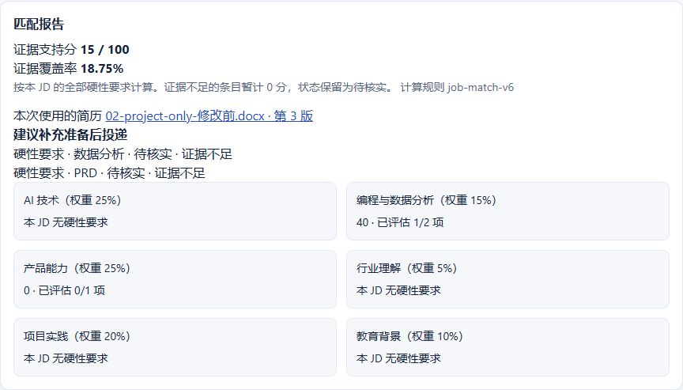
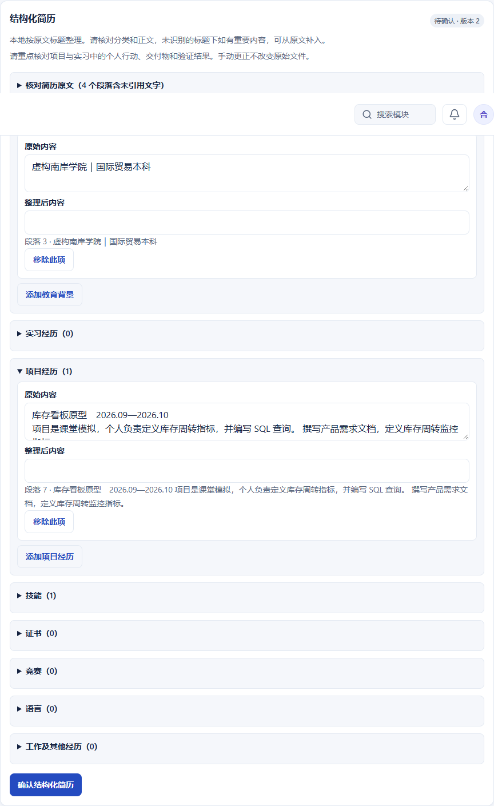
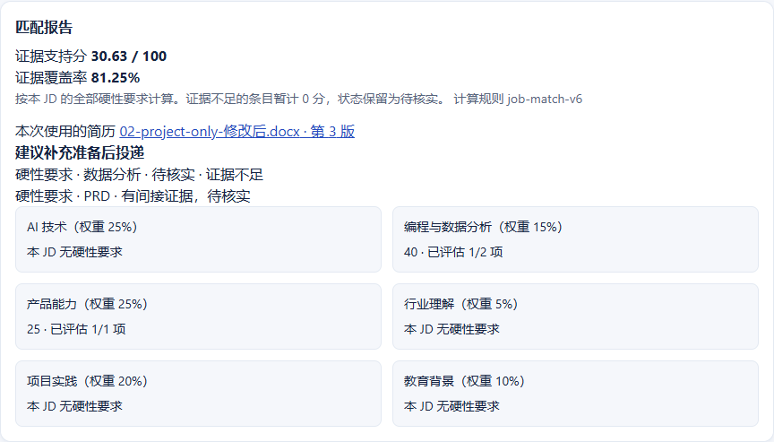

# AI Career Copilot

## 这是什么

面向准备 AI 产品经理实习的学生，逐条对照简历和岗位描述（JD），找出优先补写的经历，改完用同一份 JD 复查。

| 找到差距 | 补一段经历 | 用同一 JD 复查 |
| :---: | :---: | :---: |
| **15.00 分** · 缺少需求文档证据 | **补写** · 撰写产品需求文档（PRD），定义库存周转指标 | **30.63 分** · 引用新增原文 |
|  |  |  |

三张图来自合成账号的历史演示，点击可放大。[查看演示步骤](docs/stage11/DEMO_RESUME_REMATCH.md)

## 我解决的问题

我准备投 AI 产品实习时，经常知道自己和岗位有差距，却不知道该先改哪段简历。看同学或社区的简历能学写法，但很难判断哪些做法适合我的项目。我发起了这个项目，负责需求、流程和验收，用 Codex 协作开发，帮助用户根据目标 JD 和自己的经历做修改。

## 我做了什么决策

| 反馈 | 我的决策 | 证据 |
| --- | --- | --- |
| 看完报告，要回页面顶部确认建议 | 将预览、确认和结果放到报告同一区域 | 合成账号验证了确认流程。[首轮试用](docs/stage11/USER_TRIAL_RECAP.md) |
| 写了在读日期、实习月数，报告仍提示缺证 | 先核对简历原文，再修复匹配规则 | 用原简历复算，并补充日期换行、实习月数的回归测试。[匹配规则](docs/JOB_MATCHING.md) |
| 按建议改了简历，两版评分仍相同 | 核对简历版本和逐项判定，把工具使用频率、体验问题和改进案例纳入证据判断 | 用同一 JD 复查，新增内容进入了新版报告。[个人复查](docs/stage11/PERSONAL_RESUME_REMATCH.md) |

## 演示

**个人实测：33.21 → 76.09 分。** 我在原简历上补写了 Codex 使用与改进案例、试用中发现的体验问题，再用同一份 JD 复查。两版使用同一评分规则，原版为本地复算，新版为实际页面报告。分数衡量简历对这份 JD 的证据支持程度。[看完整个人案例](docs/stage11/PERSONAL_RESUME_REMATCH.md)

## 技术栈

React · TypeScript · FastAPI · Python · MySQL · LLM 结构化提取与 Python 规则评分

[完整作品集](docs/stage11/PORTFOLIO.md) · [三套面试讲稿](docs/stage11/INTERVIEW_PITCHES.md) · [开发与验收文档](docs/LOCAL_DEVELOPMENT.md)
