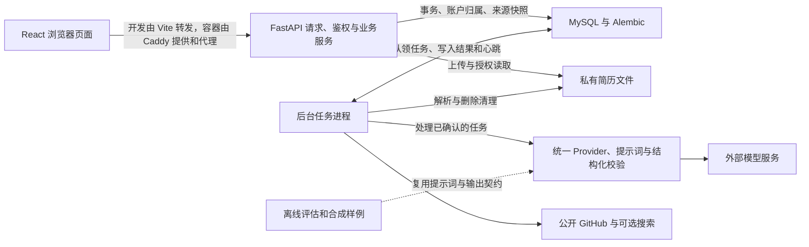

# 技术架构

## 第十阶段交付结构



快速业务请求直接返回结果，较长的 AI 任务先写入 MySQL，Worker 保存结构化输出后由页面按任务编号读取。部署配置使用一次性迁移服务和私有文件卷。离线评估重用提示词登记和输出契约。 [架构联动](CROSS_MODULE_WORKFLOW.md) [生产配置与验证边界](DEPLOYMENT.md) [AI 质量评估](AI_EVALUATION.md)

## 前八阶段跨模块数据

项目推荐关联用户的公开仓库记录。项目工作台用仓库 ID 和提交 SHA 打开面试准备页，面试快照保存 PRD、仓库、简历与 JD 匹配来源。成长诊断聚合所对照的业务记录，并由驾驶舱读取状态统计。已有数据继续由各原模块维护。

## 第八阶段成长中心

课程目录使用稳定的知识点 ID 和先修关系。FastAPI 从当前账号汇总证据，Python 负责排序、日程和掌握状态迁移。React 负责教学、作业和测评交互。百炼路线讲解、导师答复和作业反馈复用 Provider 与共享 Worker，提交前先核对有限上下文。测评和路线版本单独保存。

## 第七阶段 AI 面试训练

React 发起准备和逐轮发送预览。FastAPI 读取当前用户授权的版本快照，绑定模型请求与面试版本，再将请求入队。Worker 使用共享 Provider，在同一轮解析评价与拟议追问。Python 管理时间、阶段、题目去重、评分覆盖和持久化。面试结束时在数据库事务中保存报告与训练任务。

## 第六阶段项目工作台

React 通过受保护的项目接口选择仓库与提交。Worker 访问 GitHub 的仓库、提交、树和文本对象，将文本经 Python AST 或 TypeScript 静态解析后写入快照。知识检索按路径、符号和关键词选择带行号的片段。模型任务在核对后调用共享 Provider，Pydantic 校验产出，Python 核对片段编号并按评分点计算题目分数。掌握报告从该快照的答题、自述和反馈汇总。

## 第五阶段产品探索

两个受保护的 React 路由共享一套以会话 ID 定位的工作台。FastAPI 从当前账号读取已有档案、确认画像及岗位差距。发起 AI 步骤前，页面先展示脱敏请求，后端将输入快照、有效期和外部服务配置绑定到确认票据。共享 Worker 读取任务，Pydantic 校验结构，Python 校验证据、计算评分并归档。MySQL 保存任务、分析历史和 PRD 版本。联网研究单独配置 Tavily，最多发送三条已预览的公开词。

## 第一阶段运行结构

```text
浏览器 → main.tsx → BrowserRouter → App.tsx
                                    └─ AppLayout
                                       ├─ Sidebar + Header
                                       └─ 当前 URL 对应的页面
                                          ├─ 驾驶舱 → 演示数据 + 任务状态
                                          └─ 模块占位页 → 路由中的规划说明
```

React 用组件组织页面。驾驶舱页面决定各个区域的排列，概览、能力图和任务列表各自负责展示。TypeScript 检查传给组件的数据类型，包括任务 ID 与状态更新。Vite 提供开发服务器和按需更新，并把源码构建成浏览器可运行的静态文件。Tailwind CSS 负责响应式布局和界面样式。

路由路径、标题和分组来自 `routes.ts`。React Router 根据浏览器 URL 选择页面，`NavLink` 根据 URL 标记当前项，`AppLayout` 同步浏览器标题。未来部署静态文件时，直接访问子路径需要托管端把应用路由回退至 `index.html`。

任务列表调用 `useDemoTasks` 更新 React 状态。浏览器本地存储仅保存已完成的演示任务 ID。读取失败时以空列表开始，勾选仍可在当前页面使用。

## 第二阶段请求如何运行

```text
React 账户页或个人档案页
  → services/api.ts（同源请求，统一解析错误）
  → Vite /api 代理（开发）
  → FastAPI 路由 → 输入校验、认证依赖 → 业务服务
  → SQLAlchemy Session → PyMySQL → MySQL
```

- FastAPI 的路由将 HTTP 方法和路径映射到 Python 函数。`schemas/` 下的 Pydantic 模型限制输入字段，`UserRead` 只声明公开字段。
- SQLAlchemy ORM 把 Python 模型映射到 SQL 表，每个请求使用可关闭的数据库会话。Alembic 的版本脚本负责改表。档案的唯一外键定义一人最多一份，业务查询仍按已验证身份过滤。
- `auth_service.py` 用带盐的 Argon2id 哈希验证密码。JWT 由服务端签名，以主体、签发方、受众和有效期完成验证。JWT 载荷可被解码，因而只放身份校验所需信息。
- React 通过 `AuthProvider` 共享登录和档案状态。服务端设置短时 HttpOnly Cookie，刷新后前端请求 `/users/me` 恢复。浏览器与 Bearer 使用不同受众，Cookie 写入还需校验精确来源和自定义请求头。Cookie 同站部署的同时配置 CORS 白名单。
- `core/config.py` 从环境变量或本地 `.env` 读配置。生产环境使用独立密钥、HTTPS 和 Secure Cookie；前端产物配置同源 `/api` 反向代理。开发自带的 IP 限流在进程内运行，多实例部署需要共享限流和正确的可信代理配置。

API 约定与表结构见 [API.md](API.md) 和 [DATABASE.md](DATABASE.md)。

## 第三阶段简历与职业画像

```text
React 职业画像 → FastAPI（归属检查、文件校验、任务登记）
                           ├─ 私有文件目录
                           └─ MySQL resume_jobs ← Python worker
                                              ├─ 本地 PDF / DOCX 文字提取
                                              └─ 模型 Provider → Pydantic → 证据校验 → 版本化结果
```

- API 复用已登录账户和现有 CSRF 校验。简历归属由服务端确定。浏览器以任务 ID 轮询状态，并可在切回页面时读取任务历史。
- Worker 使用 MySQL 行锁和 `SKIP LOCKED` 认领任务，在数据库事务外处理文件和模型请求，再提交结果。已成功的同参数任务可复用。超时不会自动重发模型请求。
- 同一简历留存不可变内容版本。较早的报告继续引用当时的版本。用户确认优化建议时单独保存文本。
- Provider 仅接收经用户确认的脱敏段落和有来源的事实。能力状态依据简历证据类型，`verified` 留给后续任务验证。图表统计条目数。

## 第四阶段岗位匹配

岗位 API 将模型任务写入 MySQL。既有 Worker 依次处理简历和岗位队列。岗位解析结果经结构和原文校验后入库，用户确认后形成新的岗位要求版本。评分服务直接读取所属用户的能力证据与档案，在本地计算参考分、覆盖率和差距。报告和求职建议的结构通过 [岗位匹配文档](JOB_MATCHING.md) 核对。

## 第九阶段求职执行

React 工作台复用会话鉴权和 API 请求层，岗位详情复用匹配结果。从真实日程进入模拟面试时，FastAPI 根据用户和日程找到投递及版本快照。MySQL 原子保存状态与事件。统计服务本地计算，AI 策略通过预览令牌和后台 Worker 执行，服务商仅收到匿名计数和日期。详见 [求职执行设计和代码说明](JOB_APPLICATIONS.md)。

## 运行就绪与资料清理

API 进程存活和业务依赖就绪分别通过 `/health` 与 `/ready` 判断。完整 Worker 在队列处理之间写入数据库心跳。账户删除将数据删除与待清理文件记录写入同一事务。文件无法和 MySQL 同事务删除，Worker 可根据持久化记录重试清理。详见 [运行维护说明](OPERATIONS.md)。

## 定向工作流

投递快照保存所用的匹配报告和 JD 版本，探索会话通过可空外键关联报告及投递。模拟面试写入真实来源快照。学习路线保存报告 ID 与薄弱项，在内部更新时继续沿用。独立入口保持原有业务流程。 [架构图和接口](CROSS_MODULE_WORKFLOW.md)
