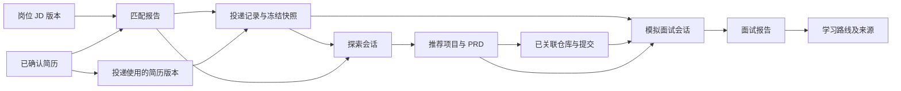

# 第十阶段 Sprint 3 · 跨模块来源绑定

## 从一条投递开始

在「求职执行 → 投递看板」打开具体记录。这里可以查看属于该投递的匹配与能力差距、投递简历和推荐项目，也可直接发起模拟面试。有真实面试日程时，仍可从日程发起同一套练习。面试完成后，从报告点击「将本次薄弱项加入学习路线」，核对来源后生成路线。



## 决定使用哪条数据

- **投递记录**保存岗位、JD 版本、简历版本和匹配报告。首次记录实际投递时，已固定的匹配报告及 JD 快照不因岗位更新而切换。如果在投递前改选简历，系统重新找该版本对应的报告。历史旧投递缺少绑定时，先按本人的岗位、JD 版本及已关联简历查找合格报告，创建定向探索时保存该报告编号。
- **探索会话**通过 `job_match_id`、`application_id` 和来源快照关联投递及报告。生成推荐时取绑定报告的差距和关联画像。来源被删除后仍可查阅历史会话，需要新建会话才能继续分析。
- **模拟面试**从投递或日程进入时，使用投递留下的 JD 与定向简历，只自动选取同一报告、同一投递或该报告的独立探索方案，以及与该方案绑定的公开仓库。没有适用方案时可以继续练习。会话创建后，资料来源和当时版本写入快照。
- **学习路线**存储所选面试报告、岗位、匹配、投递和本次薄弱项。已绑定的路线在调整预算、作业复核和测评后更新时仍保留来源。报告之后通过的阶段测评可以更新知识点的复练状态。
- 常规选岗、独立探索、独立模拟面试与普通学习路线继续支持原先入口。所有跨模块 ID 都由服务端验证归属和对应关系。

## 代码和接口

| 文件 | 职责 |
| --- | --- |
| `backend/app/services/career_context.py` | 为投递解析并校验匹配报告，筛选同一来源的推荐方案。 |
| `backend/app/services/application_tracking_service.py` | 保存报告编号和 JD 快照，控制后续更新行为。 |
| `backend/app/services/interview_preparation_service.py` | 根据投递来源准备简历、JD、项目与仓库资料。 |
| `backend/app/services/learning_plan.py` | 从具体面试报告确定复练优先级并写入路线版本。 |
| `frontend/src/components/applications/Pipeline.tsx` | 提供投递详情中的上下游入口。 |

- `GET /api/v1/job-matches/{id}` 读取本人准确的历史报告。
- `POST /api/v1/applications` 和 `POST /api/v1/discovery/sessions` 接受可选 `job_match_id`。创建探索会话也接受 `application_id`，同时提交两项时必须一致。
- `GET /api/v1/applications/{id}/career-context` 返回投递的报告、可用项目和简历版本编号。
- `GET /api/v1/interviews/options`、`POST /api/v1/interviews/prepare`、`POST /api/v1/interviews/sessions` 支持投递或日程来源。
- `GET /api/v1/learning/interview-sources/{report_id}` 查询本人面试来源。生成学习路线时提交 `interview_report_id` 绑定报告。

Alembic `20261121_0011` 为探索会话添加匹配报告外键、投递外键及来源快照。旧会话保留，旧数据无需手动补填。升级数据库并重启 API 和 Worker 后使用。

## 复测方法

从 `backend` 目录执行。先在独立测试库迁移至 `head`。

```powershell
$env:APP_ENV='test'
$env:DB_NAME='career_copilot_test'
& .venv/Scripts/python.exe -m pytest -q tests/test_career_context.py tests/test_product_acceptance.py
```

设置 `CAREER_SPRINT3_BROWSER` 指向使用测试后端的 Vite 地址，就会在双岗位用例末尾真实打开投递看板、匹配报告、推荐项目和学习路线。设置 `CAREER_ACCEPTANCE_BROWSER` 可启用同账号九阶段用例的浏览器验收。数据库查询会核对应用、探索会话、推荐、面试报告和学习路线的 ID 与实际内容。默认使用合成资料和可重复的模型回复，模型质量由后续专项评估。
