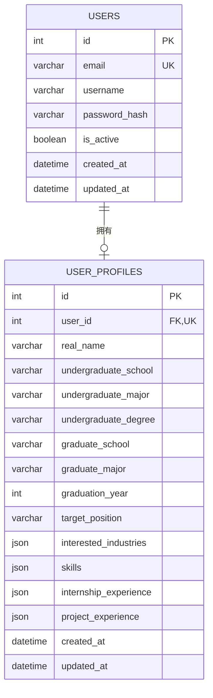
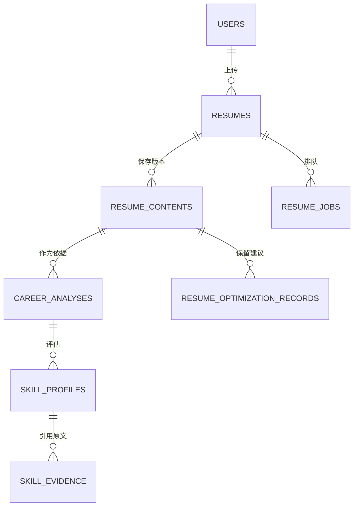

# MySQL 数据库

## 跨阶段关联迁移

`20261121_0008` 为 `github_repositories` 增加可空的 `recommendation_id`。旧仓库可继续独立使用。新关联只接收同账号已选定的方案。删除推荐记录时由外键清空关联，仓库索引、提交和测试历史仍可读取。

## 第八阶段迁移

`20261121_0007` 建立 `learning_diagnoses`、`learning_paths`、`learning_tasks`、`learning_sessions`、`learning_messages`、`learning_resources`、`learning_submissions`、`learning_evaluations`、`learning_assessments`、`learning_mastery_history` 和 `learning_jobs`。任务、作业、路线、能力历史按用户关联。稳定课程 ID 保持先修和历史映射；模块定义随路线版本快照保存。作业版本和账号任务键唯一，测评一次提交，单份提交最多一条评估。

## 第七阶段迁移

`20261121_0006` 增加 `interview_sessions`、`interview_questions`、`interview_answers`、`interview_reports`、`interview_training_tasks` 与 `interview_tasks`。会话保存由当前账号关联的来源版本。题目以父题关联追问，每题最多一条答案，每场最多一份报告。按会话绑定队列去重键，并在答题记录保留评分和 Prompt 版本。训练任务通过报告和面试归属约束访问。

## 第六阶段迁移

`20261121_0005` 新增七张表。账号关联 `github_repositories`，项目对应多个 `project_snapshots`。每个快照关联 `project_files`、`project_lessons`、`code_quizzes` 与 `quiz_attempts`。解释、导师记录、架构分析和自述共用教学表，通过 `kind` 区分。文件符号索引跟随文件，架构静态关系按快照计算，掌握报告基于答题记录汇总。`code_project_tasks` 记录异步导入、读取和教学。项目、提交、快照内路径、任务键分别有唯一性约束，API 从当前用户校验所属项目再读取下游记录。

## 第五阶段迁移

`20261121_0004` 新增 `discovery_sessions`。消息、兴趣、痛点、研究、机会、推荐和任务均关联所属会话，竞品记录关联一次研究，PRD 关联一项推荐。账号对会话及结果拥有独立权限。任务去重键和项目内的 PRD 版本号有唯一约束。现有库运行 `alembic upgrade head` 即可应用，测试库使用同一迁移。

## ER 关系



`user_profiles.user_id` 同时承担外键和唯一约束。外键保证所属账号存在，唯一约束阻止同一账号产生两份档案。外键声明了级联删除。邮箱按服务端规则转成大小写一致的值，用唯一索引抵御并发重复注册。表使用 InnoDB 和 utf8mb4，时间由 MySQL 生成，连接时区设为 UTC。档案保存使用 MySQL 的原子插入或更新。

## 此电脑上的独立实例

项目已在 `work/mysql/` 内准备 MySQL 8.4 便携文件、独立数据目录、开发库 `career_copilot` 和测试库 `career_copilot_test`。从项目根目录运行，命令会以前台方式保留，关闭时用 Ctrl+C：

```powershell
python scripts/start_local_mysql.py
```

监听地址为 `127.0.0.1:3308`，因此可以在 Navicat 新建对应的 MySQL 连接。应用使用 `backend/.env` 中的数据库账户配置。该文件和项目内的数据库运行数据、管理员初始配置属于本地文件。已有的 `3306` 和 `3307` 实例采用各自的生命周期。

## 新电脑如何初始化

可以使用已有的独立 MySQL 8.4 实例。若需要项目内便携实例，从 [MySQL Windows ZIP 安装文档](https://dev.mysql.com/doc/refman/8.4/en/windows-installation.html) 获取发行包，解压到 `work/mysql/mysql-8.4.<补丁版本>-winx64/`，按 [官方数据目录初始化步骤](https://dev.mysql.com/doc/refman/8.4/en/data-directory-initialization.html) 使用 `--initialize` 初始化 `work/mysql/data/`。文档中的路径用实际安装路径替换。保留随机生成的临时管理员密码，用 MySQL 客户端登录并先修改该密码。

用管理员在本项目实例中创建空库和专用账户。执行前把示例密码替换为独立生成的本地密码：

```sql
CREATE DATABASE career_copilot CHARACTER SET utf8mb4 COLLATE utf8mb4_unicode_ci;
CREATE DATABASE career_copilot_test CHARACTER SET utf8mb4 COLLATE utf8mb4_unicode_ci;
CREATE USER 'career_app'@'localhost' IDENTIFIED BY '<随机本地密码>';
GRANT SELECT, INSERT, UPDATE, DELETE, CREATE, ALTER, DROP, INDEX, REFERENCES
  ON career_copilot.* TO 'career_app'@'localhost';
GRANT SELECT, INSERT, UPDATE, DELETE, CREATE, ALTER, DROP, INDEX, REFERENCES
  ON career_copilot_test.* TO 'career_app'@'localhost';
```

开发用账户同时有迁移权限。部署时可让迁移和应用使用各自的账户，运行时只授予所需数据权限。

填写 `backend/.env` 后，从项目根目录建表并核对版本：

```powershell
& backend/.venv/Scripts/python.exe -m alembic -c backend/alembic.ini upgrade head
& backend/.venv/Scripts/python.exe -m alembic -c backend/alembic.ini current
& backend/.venv/Scripts/python.exe -m alembic -c backend/alembic.ini check
```

初始版本为 `20261120_0001`。查验时可以用 Navicat 查看 `users`、`user_profiles` 和 `alembic_version` 三张表。测试只应指向专用库。

## 第三阶段迁移与 ER 关系



`20261120_0002` 添加以上七张业务表，使用原有 `alembic upgrade head` 命令升级。现有账号和档案表继续使用。简历版本号、任务去重键、同次报告的能力名称分别使用组合唯一约束。

文件保存在 `work/resumes/`，数据库存随机存储键和元数据，原文件没有公开访问 URL。删除时先锁定简历并检查活动任务。允许删除时，文件和数据库关联行都会清理。文件清理失败时保留可重试状态。降级会删除第三阶段的数据表，适合空测试库或已有备份的环境。
## 第四阶段岗位匹配迁移

Alembic 版本 `20261121_0003` 新增 `job_positions`、`job_requirements`、`job_matches`、`job_skill_gaps` 和 `job_analysis_tasks`。运行 `alembic upgrade head` 升级。岗位要求以岗位、版本和序号定位。报告引用简历内容版本和可选职业画像，保存规则版本及本次证据结果。删除岗位级联删除要求、报告和任务。删除简历内容级联删除依赖该版本的报告及差距。


## 第九阶段求职执行迁移

`20261121_0009` 为 `job_positions` 新增收藏、归档和来源元数据，并新增 `resume_versions`、`job_applications`、`application_status_history`、`interview_schedules`、`job_strategy_reports`。版本、投递与日程均有用户索引，投递时间使用用户与日期组合索引。投递绑定岗位及简历版本，状态历史和日程由投递管理。一旦有关联投递，岗位保留用于追溯。迁移降级会删除第九阶段数据，运行前须备份。关系图和历史保留规则见 [第九阶段说明](JOB_APPLICATIONS.md)。
