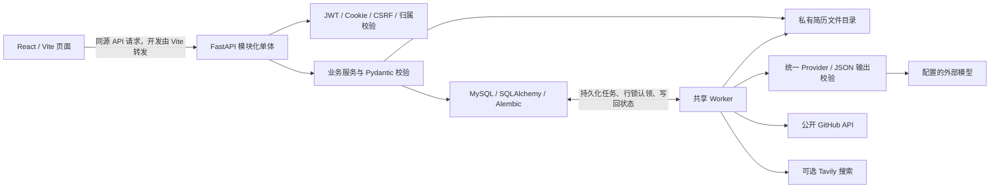

# AI Career Copilot 第十阶段系统审计

审计日期 2026 年 11 月 21 日。范围为本地前九阶段代码、迁移、测试、历史验收证据及本地启动配置。此次仅新增审计文档。运行验证使用本地服务与合成测试账号，未读取开发库中的用户业务内容。

## 1. 结论

产品已具备本地演示条件。七个业务中心的主要流程已有真实 React、FastAPI 和 MySQL 验收证据。公开上线仍有四项优先门槛：固定可回滚代码基线、完善用户删除及外部数据处理边界、增加服务就绪与故障观测、完成生产构建和备份恢复演练。前九阶段各自的验收证据不能替代同账号的九阶段完整验证。

## 2. 当前架构



FastAPI 提供请求校验、鉴权和事务入口。Worker 从 MySQL 领取长任务，网页按任务 ID 读取进度。业务表和任务表共用数据库，不需要部署额外消息服务。浏览器使用短时 HttpOnly Cookie，写请求检查来源与 CSRF 请求头，API 客户端可用不同 audience 的 Bearer 令牌。依赖由环境变量设置。代码导入为只读，现有模型调用入口不授予代码或文档内容执行权限。

## 3. 前九阶段完成度

| 阶段 | 状态 | 证据与边界 |
| --- | --- | --- |
| 1 驾驶舱、布局、导航 | 已实现且已验证 | 导航、登录回跳和浏览器布局有历史验收。登录后的目标岗位、档案和部分能力摘要来自后端。求职阶段、项目数、任务及路径仍保留演示标记。 |
| 2 账号与个人档案 | 已实现且已验证 | MySQL 认证、档案读写、会话恢复、CSRF 和隔离有自动化测试。独立的账户及派生数据删除能力尚未实现。 |
| 3 简历和职业画像 | 已实现且已验证 | 合成 PDF/DOCX、本地解析、脱敏预览、结构化确认和优化有测试及真实模型验收。扫描版 OCR 未实现。 |
| 4 岗位与匹配 | 已实现且已验证 | JD 解析、证据及硬性要求、规则评分和报告可复算。真实模型此前用于解析与建议，匹配分由本地规则计算。 |
| 5 产品探索 | 部分实现 | 痛点、补录公开来源、竞品分析、方案、PRD 有 API、浏览器和部分真实模型证据。Tavily 接口已实现，仓库内尚无有效密钥下的联网验收记录。 |
| 6 项目实践 | 已实现且已验证 | 公开 GitHub、固定提交、解释、问答、测验与掌握报告有受控测试，关键路径也有公开仓库及真实模型验收。 |
| 7 面试训练 | 已实现且已验证 | 五种模式、固定资料、追问、评分、回放和训练计划有验收。历史人工抽查发现正确但简短的答案有偏严扣分。 |
| 8 成长学习 | 已实现且已验证 | 诊断、路线、任务、AI 导师、作业与测评有浏览器、接口和模型专项记录。学习计划当前根据读取到的资料生成，指定面试薄弱项的主动同步和来源追溯仍需补齐。 |
| 9 求职执行 | 已实现且已验证 | 五组模拟账号贯通接口，Edge 验证看板、日程与跳转，MySQL 复算，百炼以五条匿名合成计数通过。岗位来源为人工输入、JD 和原链接。 |

跨模块已有实际关联。画像和匹配记录可进入探索上下文，推荐方案可绑定仓库，面试可固定 PRD 与提交，学习诊断可引用面试报告。第九阶段的日程可找到对应投递、JD 和简历快照。第十阶段要补的是从**选定岗位和投递**出发，全程沿指定记录获取项目推荐、面试报告和学习计划。当前部分服务读取最近一条适用记录，有两个岗位时不能仅靠页面入口保证始终沿用户选中的岗位走。前八阶段已经有同账号贯通用例，第九阶段另有主流程用例，还缺覆盖全部九阶段的同账号浏览器与数据库断言。 [前八阶段验收](PRODUCT_ACCEPTANCE.md) · [第九阶段验收](JOB_APPLICATIONS.md)

## 4. 后端、前端和数据清单

| 层 | 实际范围 | 状态 |
| --- | --- | --- |
| API | 162 个版本化 HTTP 操作，包含认证 4、用户与档案 3、简历与职业画像 18、岗位匹配 18、产品探索 28、项目实践 24、面试 16、成长 31、求职执行 20。另有 `GET /health`。 | 业务操作已实现，已按场景验证，逐接口行为和响应契约尚未全部验收。静态扫描显示除 4 个认证入口外其余均声明 `CurrentUser`，资源归属仍需逐项测试。 |
| 前端 | 11 个页面组件，涵盖首页、登录注册、个人档案和各业务中心。兴趣探索与项目推荐复用同页。设置路由仍为占位。 | 业务页面已验证，设置仅有前端界面。首页真实数据聚合、统一反馈与完整移动端验收部分实现。 |
| 数据库 | 10 个模型文件定义 53 张业务表，测试库实际存在 53 张业务表。9 条 Alembic 迁移，开发库和测试库均在 `20261121_0009`。 | 当前结构已验证。生产规模索引、冷恢复与备份一致性未验证。 |
| AI | 各工作流复用 `Provider`，带配置校验、字符上限、超时、结构化输出。简历与岗位有专项评估脚本，其余模块有独立样例或合成测试。 | 业务功能按上表验收。统一 AI Evaluation、Prompt Registry、按模块与用户核算成本尚未实现。 |
| 部署 | 本地 Vite、FastAPI、Worker、MySQL 和环境变量示例，FastAPI OpenAPI 显示 0.8.0，变更记录已到 0.9.0。 | 本地入口和生产静态构建已验证。Docker/Compose、生产代理、生产告警和恢复演练尚未实现。当前环境未在 PATH 找到 Docker。 |

## 5. 主要发现和修复优先级

| 优先级 | 发现与证据 | 验收条件 |
| --- | --- | --- |
| P0 | **用户删除链路缺口。** 原简历支持删除，投递定向版本的外键却使用 SET NULL 并保留内容快照。当前没有账户、投递快照、面试资料的一站式删除接口。见 [简历删除](../backend/app/services/resumes.py#L60) 和 [版本及投递模型](../backend/app/models/application.py#L20)。 | 用合成账号创建原件、版本、面试与报告，验证删除、匿名化或保留符合用户选择与产品规则。确认文件、任务、备份的处理和恢复后删除策略。 |
| P0 | **缺少可回滚发布基线。** 本地 `main` 无提交，项目源文件均未跟踪，无法以当前 Git 历史区分既有修改或回退。密钥文件、依赖和工作目录已被忽略。 | 在独立审查提交内容与敏感文件后建立首个可复建基线。用同一提交重建静态产物和迁移。 |
| P0 | **就绪检查和部署缺口。** `/health` 直接返回 OK，无法说明 MySQL 或 Worker 可用。生产代理、HTTPS、迁移职责和恢复演练尚无项目配置。见 [入口](../backend/app/main.py#L55)。 | 数据库或后台任务进程失联时有独立就绪信号，能从空环境部署、从备份恢复、回滚一次发布。 |
| P1 | **共享任务进程串行等待。** [Worker](../backend/app/resume_worker.py#L170) 逐类执行任务，单个慢模型请求会推迟其他类别的轮询。状态、去重、重试上限和失败恢复散落在各工作流。 | 保留业务语义，统一任务事件与失效约定。在停机重启、重复提交、单类模型变慢时验收任务延迟与恢复。 |
| P1 | **上传边界不统一。** [请求体中间件](../backend/app/api/upload_limit.py#L6) 只覆盖简历和 JD，成长学习的资料、作业上传在接口读取后限制文件大小。PDF 页内容长度是在解码之后检查。 | 给全部上传路由统一请求体、文件与速率上限，验证异常文件失败时前台和 Worker 都可继续服务。 |
| P1 | **会话和限流是本机形态。** 现有会话有哈希、短时效、Cookie 与 CSRF 校验。登录限流存在 API 进程内，退出只删除浏览器 Cookie，服务端没有统一撤销语义。 | 按生产进程数和代理来源验证限流；明确退出、账号停用与密钥轮换的会话行为。 |
| P1 | **调用可追溯，成本仍不可核算。** [Provider](../backend/app/ai/provider.py#L47) 记录调用名、耗时和总 Token，缺少输入/输出拆分、统一失败耗时、业务任务关联、费用和汇总查询。提示词版本存在代码中，缺少历史元数据、变量契约、回滚和版本对比。 | 逐请求记录匿名关联、状态、输入输出 Token、耗时和重试。估价表带版本，无费率时费用为空；提示词按固定测试集对照后才能提升到生产。 |
| P1 | **全量查询和重复请求。** [投递看板](../backend/app/api/v1/endpoints/applications.py#L137) 拉取全部卡片，统计把一批投递及事件装入内存。前端切换至不同视图仍请求看板、版本和概览汇总。 | 以合成数据验证分列分页和查询计划，按需加载并核对聚合口径，记录改动前后 p95、响应体积与错误率。 |
| P2 | **页面与错误形态分散。** 后端已有统一错误信封、连接工厂和会话，前端已有通用 API 层。各模块仍分别处理轮询、请求取消、重试和空态，很多接口手工组装响应。 | 先统一公共契约和观测，再以渐进方式调整轮询、上传、成功反馈及页面空态。保留此前接口兼容性。 |

第三方安全检查已确认主机受限的公开 GitHub 读取、关闭重定向、文件与响应限制、输出校验和部分签名预览。提示词把输入标为原始数据，Pydantic 验证形状，仍需用固定对抗样本验证证据引用、数据脱敏和模型无法越过权限。生产启用模型前应核对凭据是否曾在对话或工单里明文出现，有则轮换，并确认生产日志、备份与错误上报均避开内容和密钥。此轮没有运行外部扫描或生产环境攻击测试。

## 6. 测试与性能证据

- 当前前端成功通过 TypeScript 检查与生产构建。入口脚本原始体积约 450 kB，gzip 约 133 kB。职业画像懒加载脚本原始体积约 435 kB，gzip 约 124 kB。体积是构建结果，不等同于用户首屏耗时。
- 本轮本地前端页面返回 200，FastAPI 可读取 OpenAPI，未认证访问投递看板 API 返回 401。两个数据库均通过 `alembic check`。
- 本轮隔离回归 95 项通过、15 项按配置跳过。本轮执行默认测试配置，未启用需单独启动浏览器服务或调用真实外部服务的测试。首次运行因我指定的临时目录缺少上级目录，15 项在准备阶段报错。创建目录并完整重跑后通过。
- 使用独立测试库中的空合成账号，在进程内连续调用每个接口 20 次，先预热，再记录中位数和 p95。下列数字仅用于建立空数据基线，未覆盖并发、浏览器渲染、网络和 LLM。
- 现有 17 个自动化测试模块覆盖规则、权限、MySQL 集成和实际浏览器链路。前九阶段最后使用 Edge 的回归曾记录 101 项通过、9 项按配置跳过，并单独实测策略模型 1 项。当前缺少代码覆盖率与完整性能基线，不给出覆盖率百分比。

| 测试库接口 | p50 | p95 |
| --- | ---: | ---: |
| 岗位列表 | 5.8 ms | 7.0 ms |
| 投递看板 | 11.0 ms | 15.6 ms |
| 求职统计 | 10.0 ms | 12.4 ms |
| 成长诊断 | 21.5 ms | 26.8 ms |

## 7. 后续 Sprint 与验收顺序

| Sprint | 本轮建议的范围与交付 |
| --- | --- |
| 2 架构修复 | 先确定 Git 基线和删除语义。增加 API 就绪及任务心跳，制定请求 ID、错误与任务状态契约，统一上传入口和 Provider 调用元数据。保留已有模块和接口。 |
| 3 业务整合 | 从选定的岗位、匹配和投递 ID 贯通推荐、简历、模拟面试、学习。做两个岗位的反向验证，证明系统不会取错最近记录。 |
| 4 AI 评估 | 逐步把现有提示词纳入 Registry，先固定现有版本。为 12 类输出准备分版本样本和可复算指标。用规则和人工标注为主，评审模型提供辅助，报告保留失败例。 |
| 5 性能与安全 | 复测文件边界、多进程限流、删除恢复、第三方发送范围与提示注入风险。在合成数据量阶梯上测 MySQL、API、Worker 与页面。基于结果优化分页、查询与上下文。 |
| 6 体验统一 | 建立登录后真实首页。职业能力、能力差距、项目、任务、面试、投递及下一步均由真实接口提供。统一空态、失败提示和移动端。 |
| 7 部署准备 | 实现前端静态与反向代理、API 与同镜像 Worker、MySQL 或外接实例的部署配置。支持同源 HTTPS、迁移、持久卷、健康检查、备份、恢复与回滚。 |
| 8 端到端验收 | 用隔离环境运行六条核心场景和同账号全链。检查数据库关联、AI 输出证据、浏览器刷新和故障恢复。合成受控响应与真实模型结果分别记录。 |
| 9 用户验证准备 | 设计至少五位目标用户的测试协议、成功条件、隐私说明与回访。先定义激活和七日留存等指标，再验证免费基础、付费训练和机构方案。 |

各 Sprint 等待确认后开始。公网发布、执行破坏性迁移及真实用户招募都需按任务要求另行确认。

## 附录　项目完整源文件清单

按本地 Git 忽略规则列出项目文件，省略依赖、缓存、构建产物、工作库和密钥文件。

```text
.
├── backend/
│   ├── alembic/
│   │   ├── versions/
│   │   │   ├── 20261120_0001_users_and_profiles.py
│   │   │   ├── 20261120_0002_add_resumes_and_career_analysis.py
│   │   │   ├── 20261121_0003_add_job_matching.py
│   │   │   ├── 20261121_0004_add_product_discovery.py
│   │   │   ├── 20261121_0005_add_project_mentor.py
│   │   │   ├── 20261121_0006_add_mock_interviews.py
│   │   │   ├── 20261121_0007_add_learning_mentor.py
│   │   │   ├── 20261121_0008_link_recommendation_to_project_workspace.py
│   │   │   └── 20261121_0009_add_job_application_workspace.py
│   │   ├── env.py
│   │   └── script.py.mako
│   ├── app/
│   │   ├── ai/
│   │   │   ├── code_project_prompts.py
│   │   │   ├── discovery_prompts.py
│   │   │   ├── evidence.py
│   │   │   ├── interview_prompts.py
│   │   │   ├── job_strategy_prompts.py
│   │   │   ├── learning_prompts.py
│   │   │   ├── prompts.py
│   │   │   └── provider.py
│   │   ├── api/
│   │   │   ├── v1/
│   │   │   │   ├── endpoints/
│   │   │   │   │   ├── applications.py
│   │   │   │   │   ├── auth.py
│   │   │   │   │   ├── career.py
│   │   │   │   │   ├── code_projects.py
│   │   │   │   │   ├── discovery.py
│   │   │   │   │   ├── interviews.py
│   │   │   │   │   ├── jobs.py
│   │   │   │   │   ├── learning.py
│   │   │   │   │   ├── profiles.py
│   │   │   │   │   ├── resumes.py
│   │   │   │   │   └── users.py
│   │   │   │   └── api.py
│   │   │   ├── dependencies.py
│   │   │   └── upload_limit.py
│   │   ├── core/
│   │   │   ├── config.py
│   │   │   ├── errors.py
│   │   │   ├── job_scoring.py
│   │   │   ├── rate_limit.py
│   │   │   └── security.py
│   │   ├── db/
│   │   │   ├── base.py
│   │   │   └── session.py
│   │   ├── models/
│   │   │   ├── application.py
│   │   │   ├── career.py
│   │   │   ├── code_project.py
│   │   │   ├── discovery.py
│   │   │   ├── interview.py
│   │   │   ├── job.py
│   │   │   ├── learning.py
│   │   │   ├── resume.py
│   │   │   ├── user.py
│   │   │   └── user_profile.py
│   │   ├── schemas/
│   │   │   ├── application.py
│   │   │   ├── auth.py
│   │   │   ├── career.py
│   │   │   ├── code_project.py
│   │   │   ├── discovery.py
│   │   │   ├── interview.py
│   │   │   ├── job.py
│   │   │   ├── learning.py
│   │   │   ├── profile.py
│   │   │   └── user.py
│   │   ├── services/
│   │   │   ├── application_tracking_service.py
│   │   │   ├── auth_service.py
│   │   │   ├── career.py
│   │   │   ├── code_project_workflow.py
│   │   │   ├── codebase_parser.py
│   │   │   ├── competitor_analysis_service.py
│   │   │   ├── discovery_workflow.py
│   │   │   ├── github_service.py
│   │   │   ├── interest_discovery_service.py
│   │   │   ├── interview_engine.py
│   │   │   ├── interview_evaluation_service.py
│   │   │   ├── interview_modes.py
│   │   │   ├── interview_preparation_service.py
│   │   │   ├── interview_report_service.py
│   │   │   ├── interview_schedule_service.py
│   │   │   ├── interview_training_service.py
│   │   │   ├── job_discovery_service.py
│   │   │   ├── job_matching_service.py
│   │   │   ├── job_parser.py
│   │   │   ├── job_pipeline_service.py
│   │   │   ├── job_strategy_service.py
│   │   │   ├── job_workflow.py
│   │   │   ├── learning_assessment.py
│   │   │   ├── learning_catalog.py
│   │   │   ├── learning_plan.py
│   │   │   ├── learning_resources.py
│   │   │   ├── learning_workflow.py
│   │   │   ├── market_research_service.py
│   │   │   ├── opportunity_evaluation_service.py
│   │   │   ├── pain_point_service.py
│   │   │   ├── profile_service.py
│   │   │   ├── project_knowledge_service.py
│   │   │   ├── project_recommendation_service.py
│   │   │   ├── resume_jobs.py
│   │   │   ├── resume_parser.py
│   │   │   ├── resume_storage.py
│   │   │   ├── resume_version_service.py
│   │   │   ├── resumes.py
│   │   │   └── skill_gap_service.py
│   │   ├── main.py
│   │   └── resume_worker.py
│   ├── tests/
│   │   ├── fixtures/
│   │   │   └── resume_cases.json
│   │   ├── conftest.py
│   │   ├── evaluate_job_model.py
│   │   ├── evaluate_resume_model.py
│   │   ├── interview_cases.py
│   │   ├── job_cases.py
│   │   ├── resume_fixtures.py
│   │   ├── test_api.py
│   │   ├── test_applications.py
│   │   ├── test_applications_browser.py
│   │   ├── test_browser.py
│   │   ├── test_career_browser.py
│   │   ├── test_code_project_browser.py
│   │   ├── test_code_projects.py
│   │   ├── test_discovery.py
│   │   ├── test_discovery_browser.py
│   │   ├── test_interview_browser.py
│   │   ├── test_interviews.py
│   │   ├── test_job_browser.py
│   │   ├── test_jobs.py
│   │   ├── test_learning.py
│   │   ├── test_learning_browser.py
│   │   ├── test_product_acceptance.py
│   │   └── test_resumes.py
│   ├── tools/
│   │   └── index_js.cjs
│   ├── .env.example
│   ├── alembic.ini
│   ├── requirements-test.txt
│   └── requirements.txt
├── docs/
│   ├── examples/
│   │   ├── discovery-competitor.md
│   │   ├── interview-review.md
│   │   ├── learning-sql.md
│   │   └── project-mentor-queue.md
│   ├── API.md
│   ├── ARCHITECTURE.md
│   ├── CHANGELOG.md
│   ├── DATABASE.md
│   ├── INTERVIEW.md
│   ├── JOB_APPLICATIONS.md
│   ├── JOB_MATCHING.md
│   ├── LEARNING.md
│   ├── PRD.md
│   ├── PRODUCT_ACCEPTANCE.md
│   ├── PRODUCT_DISCOVERY.md
│   ├── PROJECT_MENTOR.md
│   ├── RESUME_AI.md
│   ├── SYSTEM_AUDIT.md
│   └── TEST_PLAN.md
├── frontend/
│   ├── src/
│   │   ├── components/
│   │   │   ├── applications/
│   │   │   │   ├── Analytics.tsx
│   │   │   │   ├── Pipeline.tsx
│   │   │   │   ├── Positions.tsx
│   │   │   │   ├── ResumeVersions.tsx
│   │   │   │   ├── Schedules.tsx
│   │   │   │   └── shared.tsx
│   │   │   ├── auth/
│   │   │   │   ├── LogoutButton.tsx
│   │   │   │   └── ProtectedRoute.tsx
│   │   │   ├── career/
│   │   │   │   ├── EvidenceReport.tsx
│   │   │   │   ├── OptimizationCard.tsx
│   │   │   │   └── ResumeFacts.tsx
│   │   │   ├── dashboard/
│   │   │   │   ├── CoreModules.tsx
│   │   │   │   ├── GrowthPath.tsx
│   │   │   │   ├── Overview.tsx
│   │   │   │   ├── RecentTasks.tsx
│   │   │   │   ├── SkillProfile.tsx
│   │   │   │   └── Welcome.tsx
│   │   │   ├── discovery/
│   │   │   │   └── DiscoveryEditors.tsx
│   │   │   ├── interview/
│   │   │   │   └── InterviewReport.tsx
│   │   │   ├── jobs/
│   │   │   │   └── JobReport.tsx
│   │   │   ├── layout/
│   │   │   │   ├── AppLayout.tsx
│   │   │   │   ├── Header.tsx
│   │   │   │   └── Sidebar.tsx
│   │   │   ├── learning/
│   │   │   │   └── LearningPanels.tsx
│   │   │   └── mentor/
│   │   │       └── CodeEvidence.tsx
│   │   ├── data/
│   │   │   └── dashboardMock.ts
│   │   ├── hooks/
│   │   │   ├── AuthProvider.tsx
│   │   │   └── useDemoTasks.ts
│   │   ├── pages/
│   │   │   ├── ApplicationWorkspacePage.tsx
│   │   │   ├── AuthPage.tsx
│   │   │   ├── CareerProfilePage.tsx
│   │   │   ├── DashboardPage.tsx
│   │   │   ├── GrowthCenterPage.tsx
│   │   │   ├── InterviewPracticePage.tsx
│   │   │   ├── JobMatchingPage.tsx
│   │   │   ├── ModulePlaceholderPage.tsx
│   │   │   ├── ProductDiscoveryPage.tsx
│   │   │   ├── ProfilePage.tsx
│   │   │   └── ProjectWorkspacePage.tsx
│   │   ├── services/
│   │   │   ├── api.ts
│   │   │   ├── applications.ts
│   │   │   ├── auth.ts
│   │   │   ├── career.ts
│   │   │   ├── codeProjects.ts
│   │   │   ├── discovery.ts
│   │   │   ├── interview.ts
│   │   │   ├── jobs.ts
│   │   │   ├── learning.ts
│   │   │   └── profile.ts
│   │   ├── App.tsx
│   │   ├── index.css
│   │   ├── main.tsx
│   │   └── routes.ts
│   ├── .env.example
│   ├── index.html
│   ├── package-lock.json
│   ├── package.json
│   ├── tsconfig.json
│   └── vite.config.ts
├── scripts/
│   └── start_local_mysql.py
├── .gitignore
├── AGENTS.md
└── README.md
```
