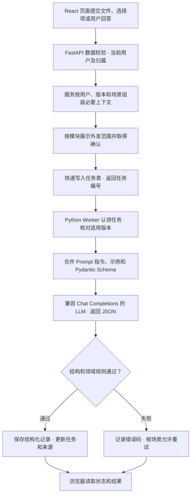
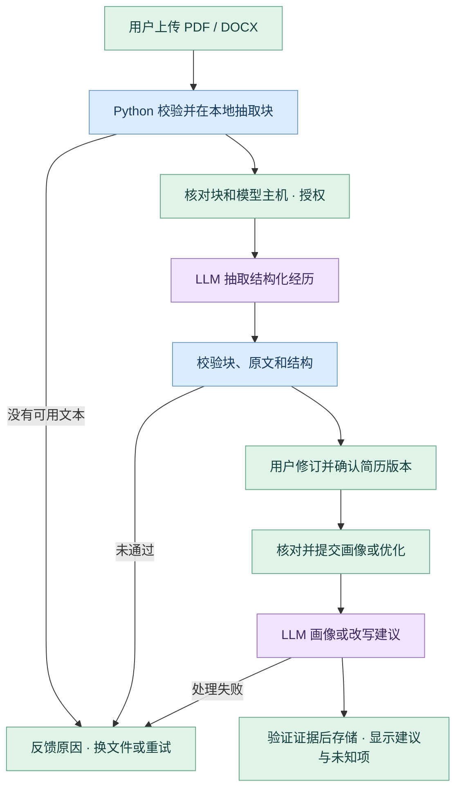
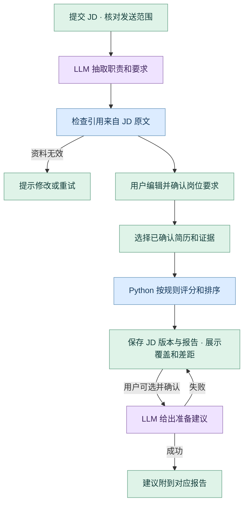
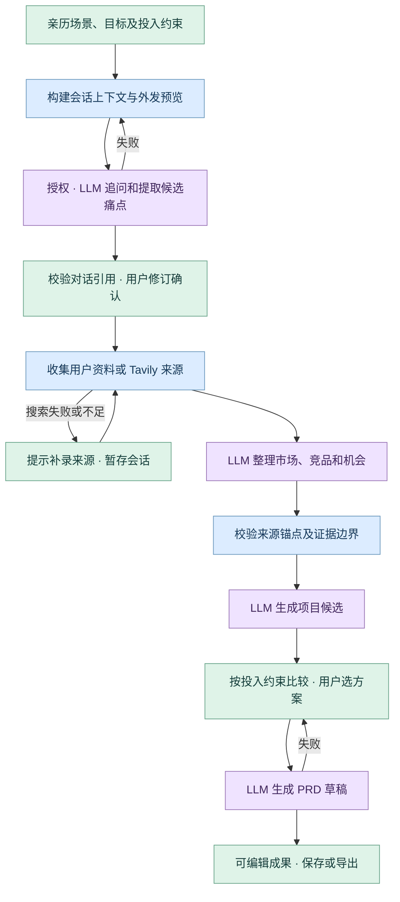
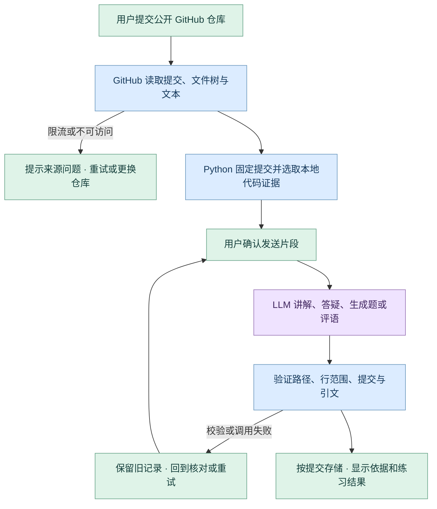
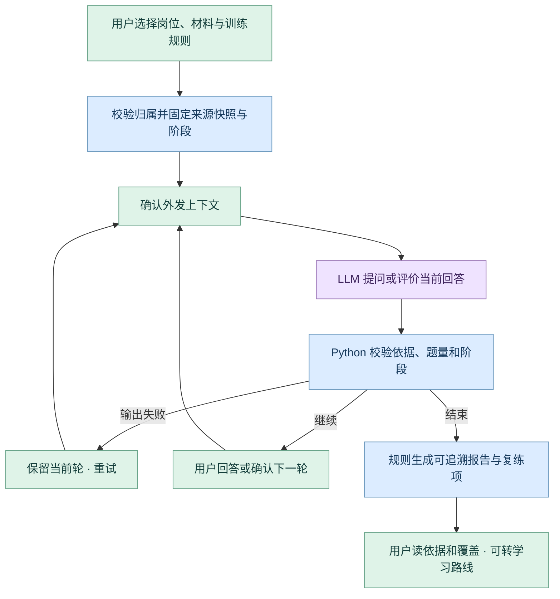
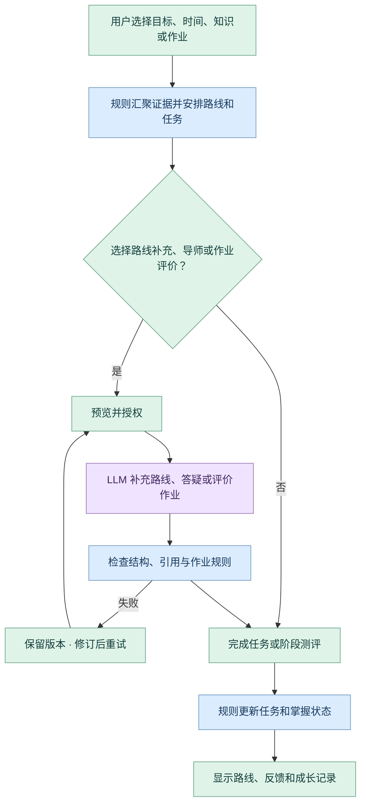

# AI Career Copilot AI 工作流

阶段 11.3 · 依据现有实现 · 2026 年 11 月 22 日

本文覆盖六条工作流。图中蓝色节点是 Python 业务逻辑，紫色节点是模型生成，绿色节点是用户确认或结果反馈。图中的错误路径描述产品反馈；不同模块的任务状态、重试条件与用户可编辑的数据各有差异。

## 0. 共享 AI 技术架构

### 请求、上下文和落库

1. **触发与确认。** 前端服务向 FastAPI 提交经检查的数据。业务按当前用户、选定简历、JD 修订、Git 提交或聊天会话组装上下文。简历提取以核对过的段落、隐藏块、提供方主机和同意标记为依据；产品探索、项目导师、面试和成长使用对应的预览票据，失效或上下文改变后需重新核对。
2. **提示词与调用。** 生产端模块以代码中的 `Prompt` 定义传入 Provider，包含名称、版本、指令和示例。Provider 从 Pydantic 构建 Schema，分别发送系统指令和 JSON 用户数据，限制输入和输出，按环境配置使用 `json_object` 或 `json_schema`。Registry 为基线、版本与测试登记契约；生产 Worker 直接导入相应模块的 Prompt。
3. **输出校验与写入。** `Provider.generate` 拒绝空、截断或无效 JSON，并调用 `model_validate_json` 验证返回值。不同业务继续验证引文、版本、证据、题量和权限，再写入所属模型与任务终态。状态轮询用于反馈等待、失败和结果，通知状态无需依赖模型。
4. **失败与可观测性。** 配置缺失、权限、连接失败、限流、超时等有独立错误码。生产请求不会在 Provider SDK 中隐式重试。业务任务可按场景手动重试，已生成的报告按来源保留。模型监控记录版本、耗时、状态与可获得的用量，成本依赖 Token 和已配置单价。

依据 [Provider](../../backend/app/ai/provider.py)、[Prompt Registry](../../backend/app/prompts/registry.py)、[异步入口](../../backend/app/resume_worker.py)、[调度器](../../backend/app/services/worker_scheduler.py) 和 [模型监控](../../backend/app/services/llm_monitoring_service.py)。

### AI 能力核对

| 能力 | 判定与代码依据 |
| --- | --- |
| Agent 自主规划与工具编排 | **尚未实现。** 任务种类、Python 执行顺序、状态与外部调用均在代码中定义。历史 PRD 将进一步引入 Agent 作为规划。 |
| RAG | **部分机制已实现。** 对公开仓库按路径、符号和关键词取带行号的证据注入 Prompt，具备检索增强语境。完整向量化 RAG 管线尚未实现。市场搜索和公开摘录是另一个按步骤调用的输入来源。 [代码证据检索](../../backend/app/services/project_knowledge_service.py) |
| Embedding、向量数据库 | **尚未实现。** 当前代码证据检索是词项和符号规则；持久化使用 MySQL 普通表、文本和 JSON。 |
| Function Calling | **尚未实现。** 模型调用没有传入 `tools` 或 `tool_choice`，GitHub 和 Tavily 由 Python 主动调用。 [Provider](../../backend/app/ai/provider.py) |
| Structured Output | **已实现并有结构/负例测试。** Provider 支持 JSON Schema 请求模式；本地始终进行 Pydantic 验证。百炼历史基线用 `json_object`，结构和领域正确性分别度量。 [历史评估](../AI_EVALUATION.md) |
| Multi-turn Conversation | **已实现且已有合成链路验证。** 探索、面试和导师会话使用数据库逐轮记录。模块按会话、当前题或证据选择上下文；模型请求本身独立，轮次、时限与结题由代码控制。 [端到端验收](../PRODUCT_ACCEPTANCE.md) |

## 1. 共同机制

React 调用 API。经授权的异步请求进入各自任务表，由后台 Worker 获取。服务层按用户校验数据和版本，为模型准备必要上下文，在适用的流程检查发送确认、实际提供方和 Prompt 版本。共享 [Provider](../../backend/app/ai/provider.py) 调用环境配置指定的模型。Pydantic 验证返回结构，服务层再核对证据、适用版本和业务状态，最终将结果写入数据库。前端读取排队、处理、成功和失败状态。模型供应商可由配置变化，工作流和数据库结构无需随模型名称变化。

- **确定性逻辑**包括文件本地解析、身份和归属校验、去重、版本绑定、任务状态、验证输出结构、计算匹配分、安排学习任务和保存结果。
- **模型生成**用于抽取和总结非结构化资料、建议、教学文本、题目、追问与评语。结构校验可以确认格式与字段，证据核对进一步检查引用。用户仍需确认其是否忠于实际经历。
- **上下文约束**通过模块的来源和版本保存。简历块、JD 原文、探索原话、代码片段、面试问题和回答、学习任务有各自的证据规则。用户输入、网页和仓库内容是待分析材料。
- **操作失败**可区分提供方配置、限流、网络、格式、权限和资料变动。任务应留下可读的失败原因；修改输入或切换提供方后按对应操作重新预览或提交。
- **评估证据**见 [AI 质量评估](../AI_EVALUATION.md)、[历史产品验收](../PRODUCT_ACCEPTANCE.md) 和 [Prompt 注册表](../../backend/app/prompts/registry.py)。本轮对照源码和截图，真实模型质量及线上运行情况由相应专项验收覆盖。

## 2. 简历分析

| 要素 | 实际实现 |
| --- | --- |
| 输入和上下文 | PDF/DOCX 文件、解析块、用户隐藏的敏感块、已确认事实版本、目标方向。 |
| Prompt 和模型 | [prompts.py](../../backend/app/ai/prompts.py) 中 EXTRACT、ANALYZE、OPTIMIZE。共享 Provider 返回结构化简历、职业画像或优化建议。 |
| 业务规则及校验 | 本地解析与文件校验、块编号与原文核对、授权、版本匹配、Pydantic 模型校验。不能从缺少证据推断已具备技能。 |
| 工具和数据库 | 本地 PDF/DOCX 解析和文件存储，模型通过外部 Provider。简历及版本、任务、画像、技能证据、优化建议持久化。 |
| 输出及异常 | 用户看到本地预览、结构化事实及可编辑版本、可追溯画像和建议；无文本、配置或结构失败按任务阶段显示与重试。 |

代码入口 [resume_worker.py](../../backend/app/resume_worker.py) 和 [resume_jobs.py](../../backend/app/services/resume_jobs.py)。

## 3. 岗位匹配

| 要素 | 实际实现 |
| --- | --- |
| 输入和上下文 | JD 文本、确认后的岗位要求与版本、特定简历内容版本、可用画像和用户自评。 |
| Prompt 和模型 | [job_parser.py](../../backend/app/services/job_parser.py) 的 JD_PROMPT；[skill_gap_service.py](../../backend/app/services/skill_gap_service.py) 的建议 Prompt。模型负责解析和可选的行动建议。 |
| 业务规则及校验 | 原句、归属、版本、证据等级、硬门槛、已评估范围、匹配分和差距优先级由 Python 处理。缺证据的要求保持待核对。 |
| 工具和数据库 | 文件导入沿用本地文本读取；模型调用 Provider。写入岗位、要求、匹配报告、差距及分析任务。 |
| 输出及异常 | 用户看到分项、证据覆盖和优先差距。可复用原 JD 版本生成新报告；建议任务失败时原规则报告保留。 |

代码入口 [job_workflow.py](../../backend/app/services/job_workflow.py)、[job_matching_service.py](../../backend/app/services/job_matching_service.py) 和 [skill_gap_service.py](../../backend/app/services/skill_gap_service.py)。

## 4. 产品探索

| 要素 | 实际实现 |
| --- | --- |
| 输入和上下文 | 亲身经历、目标和时间、当前会话消息、确认痛点、公开摘录，可选绑定的投递或匹配报告及差距。 |
| Prompt 和模型 | [discovery_prompts.py](../../backend/app/ai/discovery_prompts.py) 的追问、痛点、机会、推荐和 PRD，以及竞品分析服务中的 Prompt。 |
| 业务规则及校验 | 服务端重建预览、校验来源归属及修订号。检查原话与摘录引用，按时间投入处理候选顺序。 |
| 工具和数据库 | 可用 Tavily 搜索或补录公开来源，使用 Provider 归纳。保存会话、消息、痛点、调研、竞品、机会、推荐、PRD 版本及任务。 |
| 输出及异常 | 可解释项目候选和可编辑 PRD。无来源的描述为假设；搜索缺少配置、限流或模型失败可调整输入、补录来源或重试。 |

代码入口 [discovery_workflow.py](../../backend/app/services/discovery_workflow.py)、[market_research_service.py](../../backend/app/services/market_research_service.py) 及 [competitor_analysis_service.py](../../backend/app/services/competitor_analysis_service.py)。

## 5. 项目代码理解

| 要素 | 实际实现 |
| --- | --- |
| 输入和上下文 | 公开 GitHub 地址、选中的提交和文件、用户问题、练习答案、限定代码片段。 |
| Prompt 和模型 | [code_project_prompts.py](../../backend/app/ai/code_project_prompts.py) 的讲解、问答、测验和评估提示。 |
| 业务规则及校验 | 校验仓库地址和访问范围，冻结提交，按限制读取文本，提取可引用代码，校验引用和已评估范围。用户自述与答题结果分开。 |
| 工具和数据库 | GitHub API、文件及代码解析、共享 Provider；项目、提交快照、文件、讲解、测验、答题和任务保存。 |
| 输出及异常 | 仓库结构、代码证据、带引用的教学和掌握报告。API 配额、仓库或文件不可读、模型配置变动或结构失败时提示。 |

代码入口 [code_project_workflow.py](../../backend/app/services/code_project_workflow.py)、[github_service.py](../../backend/app/services/github_service.py) 和 [codebase_parser.py](../../backend/app/services/codebase_parser.py)。

## 6. 模拟面试

| 要素 | 实际实现 |
| --- | --- |
| 输入和上下文 | 目标、模式、难度、阶段与时间、可选投递和日程、岗位与简历、方案、固定提交代码、当前问题和回答。 |
| Prompt 和模型 | [interview_prompts.py](../../backend/app/ai/interview_prompts.py) 的开题和回答评价。模型提供问题草稿、评价和可能的追问。 |
| 业务规则及校验 | 快照绑定，校验当前回合、引用和阶段预算，在限时或用户提前结束后根据已答证据汇总。 |
| 工具和数据库 | 外部调用为 Provider，代码依据来自固定快照。保存会话、问题、答案、任务、报告和复练记录。 |
| 输出及异常 | 显示作答覆盖、参考分、逐题证据、薄弱项。未答维度保留未评估，生成失败可重试原轮，报告可作为学习路线来源。 |

代码入口 [interview_engine.py](../../backend/app/services/interview_engine.py)、[interview_preparation_service.py](../../backend/app/services/interview_preparation_service.py) 及 [interview_report_service.py](../../backend/app/services/interview_report_service.py)。

## 7. 成长导师

| 要素 | 实际实现 |
| --- | --- |
| 输入和上下文 | 目标、投入时间、档案、画像/匹配/项目/面试证据、知识点、导师历史、作业和阶段测评结果。 |
| Prompt 和模型 | [learning_prompts.py](../../backend/app/ai/learning_prompts.py) 的路线补充、导师和评估提示。 |
| 业务规则及校验 | Python 按知识目录、证据状态、优先级和时间预算生成路线及任务，检查提交、评分和掌握状态，基于阶段测评加入证据。 |
| 工具和数据库 | 本地目录、资源与作业规则及外部 Provider。保存路线、任务、导师消息、作业版本、测评、掌握历史及异步任务。 |
| 输出及异常 | 学习计划、解释、作业反馈、阶段测评及成长报告。外发失败保留记录，受支持的任务按预览重试；普通路线仍可由后端规则生成。 |

代码入口 [learning_workflow.py](../../backend/app/services/learning_workflow.py)、[learning_plan.py](../../backend/app/services/learning_plan.py) 和 [learning_assessment.py](../../backend/app/services/learning_assessment.py)。
