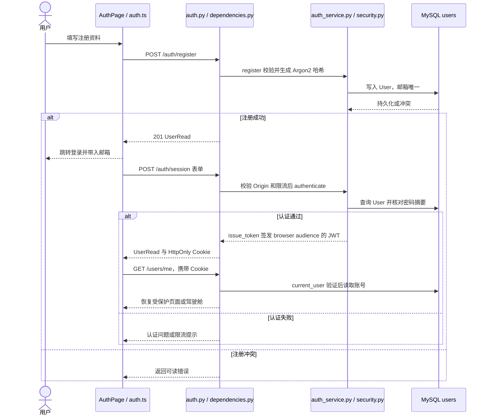
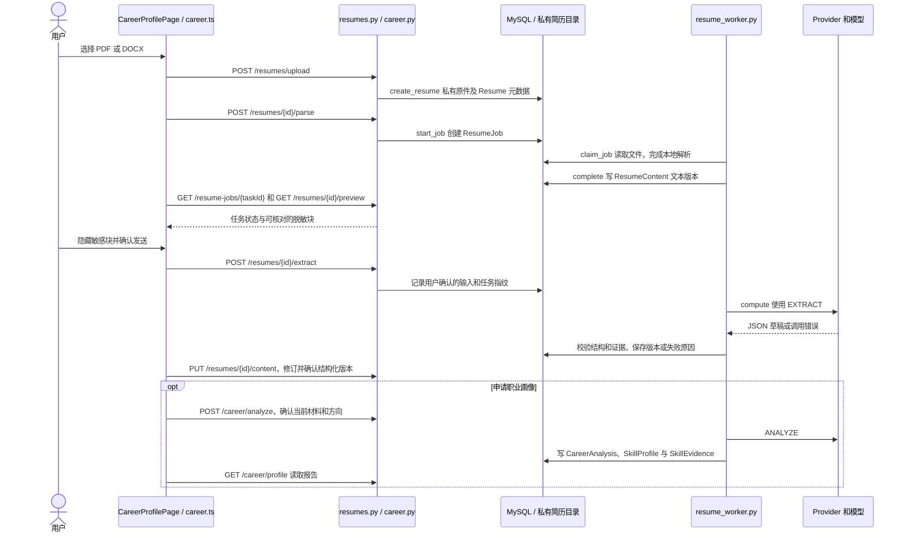
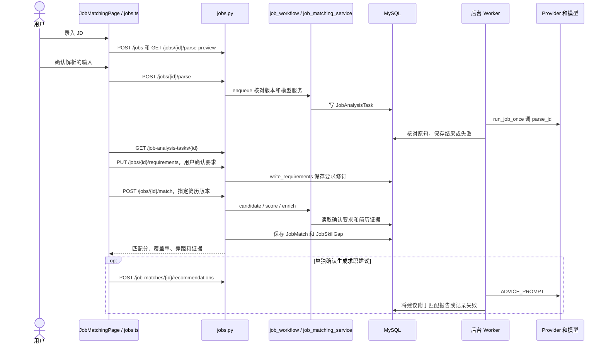
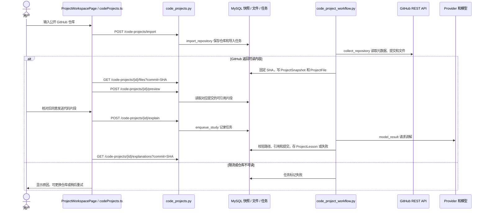
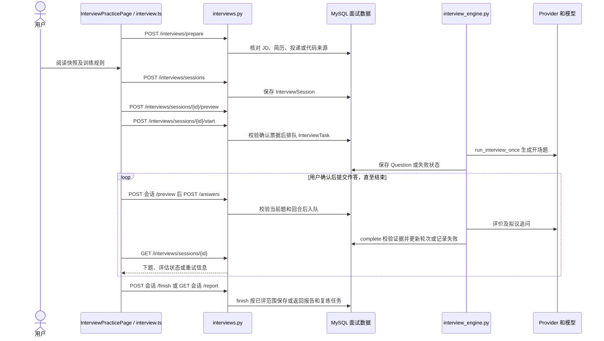
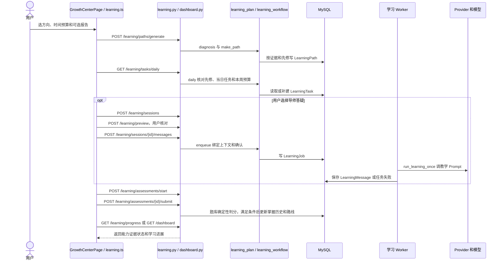

# AI Career Copilot 架构图与业务时序

阶段 11.4 · 2026 年 11 月 22 日

[系统总体架构](SYSTEM_ARCHITECTURE.md) · [AI 技术架构](AI_WORKFLOW.md) · [数据库 ER 图](DATABASE_DESIGN.md)

图中 API 路径省略 `/api/v1`，{} 表示路径参数。API 与 Service 都运行在 FastAPI 进程；后台 Worker 是另一进程，使用相同数据模型。

图表使用 GitHub Markdown 的 `mermaid` 代码块。阶段验收在本地 Mermaid 11.12.0 中进行。GitHub 页面采用其部署的渲染版本。 [GitHub 图表文档](https://docs.github.com/en/get-started/writing-on-github/working-with-advanced-formatting/creating-diagrams)

## 1. 用户注册与登录

依据 [账户页](../../frontend/src/pages/AuthPage.tsx)、[认证路由](../../backend/app/api/v1/endpoints/auth.py)、[认证服务](../../backend/app/services/auth_service.py)、[当前用户依赖](../../backend/app/api/dependencies.py) 和 [用户模型](../../backend/app/models/user.py)。

## 2. 简历上传与 AI 解析

依据 [简历路由](../../backend/app/api/v1/endpoints/resumes.py)、[职业画像路由](../../backend/app/api/v1/endpoints/career.py)、[任务入队](../../backend/app/services/resume_jobs.py)、[Worker](../../backend/app/resume_worker.py) 和 [简历模型](../../backend/app/models/resume.py)。失败可见任务原因，用户可调整后按对应操作重试。

## 3. 岗位 JD 智能匹配

依据 [岗位路由](../../backend/app/api/v1/endpoints/jobs.py)、[JD 任务](../../backend/app/services/job_workflow.py)、[规则评分](../../backend/app/services/job_matching_service.py) 及 [岗位模型](../../backend/app/models/job.py)。版本冲突时重新读取材料，建议失败仍可查看规则报告。

## 4. GitHub 项目导入与代码理解

依据 [项目路由](../../backend/app/api/v1/endpoints/code_projects.py)、[项目工作流](../../backend/app/services/code_project_workflow.py)、[代码选材](../../backend/app/services/project_knowledge_service.py)、[GitHub 服务](../../backend/app/services/github_service.py) 和 [项目模型](../../backend/app/models/code_project.py)。

## 5. AI 模拟面试

依据 [面试路由](../../backend/app/api/v1/endpoints/interviews.py)、[面试引擎](../../backend/app/services/interview_engine.py)、[结束与评分汇总](../../backend/app/services/interview_report_service.py) 和 [面试模型](../../backend/app/models/interview.py)。引擎也可在最后一轮自动完成，提前结束仍展示覆盖范围。

## 6. AI 学习任务与能力画像更新

依据 [学习 API](../../backend/app/api/v1/endpoints/learning.py)、[学习规则](../../backend/app/services/learning_plan.py)、[学习任务](../../backend/app/services/learning_workflow.py)、[学习模型](../../backend/app/models/learning.py) 和 [驾驶舱聚合](../../backend/app/services/dashboard_service.py)。这里更新的是学习能力诊断和驾驶舱聚合。阶段测评保留历史，并与原简历职业画像的证据记录分别维护。
