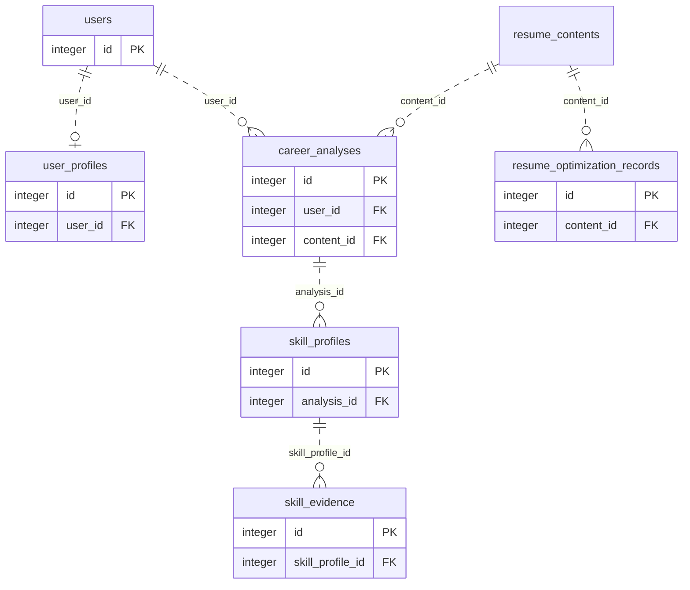
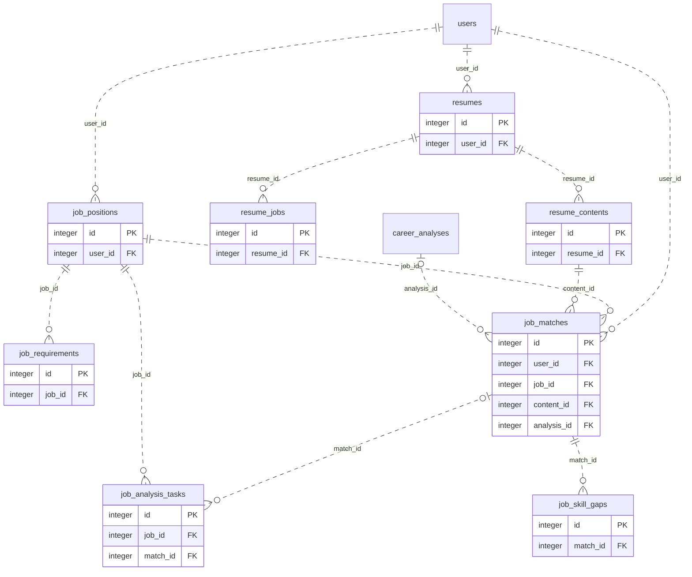
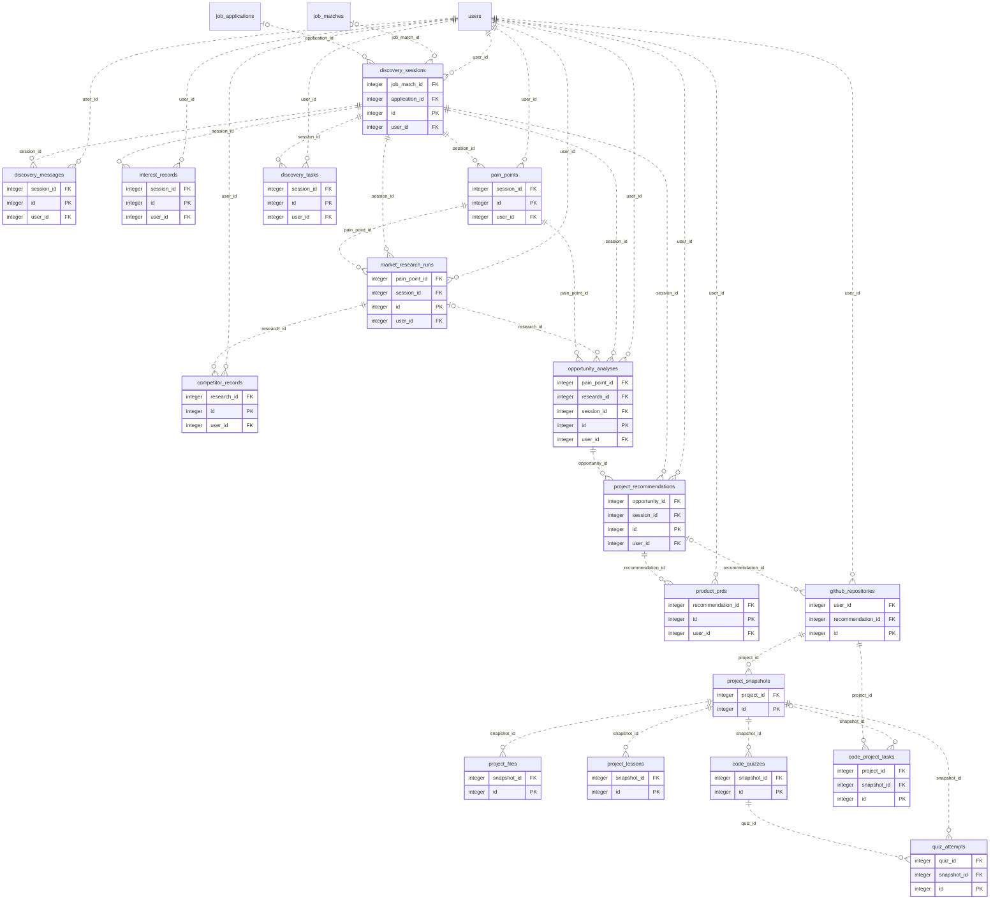
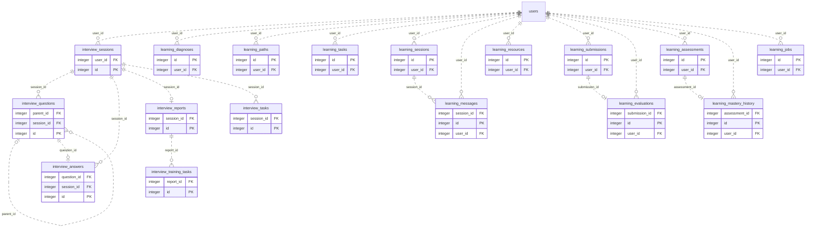
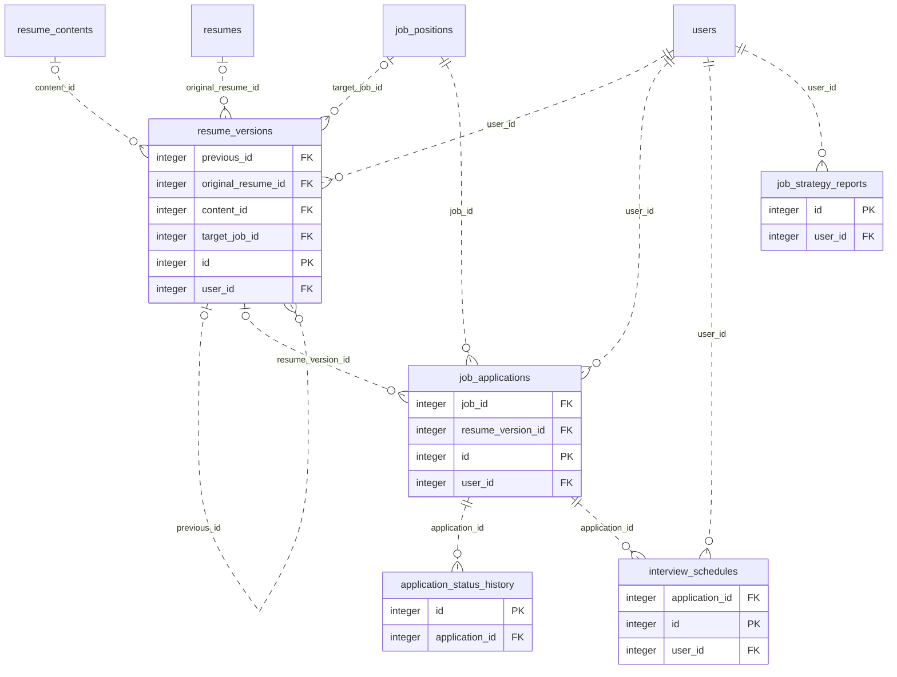
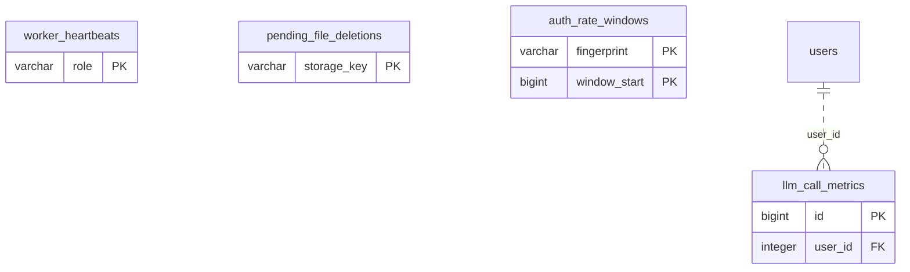

# AI Career Copilot 数据库设计

阶段 11.4 · 2026 年 11 月 22 日

以下收录 SQLAlchemy 的 57 张应用表。以 MySQL 方言显示字段类型，用 Alembic 离线升级 SQL 的建表清单交叉核对。数据库另维护迁移工具的 `alembic_version`，该表不属于应用模型。迁移头为 `20261121_0012`。线上实际迁移状态需在对应环境查询。

依据 [SQLAlchemy Models](../../backend/app/models)、[Alembic 迁移](../../backend/alembic/versions)、[当前迁移环境](../../backend/alembic/env.py) 和 [跨模块工作流](../CROSS_MODULE_WORKFLOW.md)。

## 阅读说明

- ER 图展示主键、外键和基数。其他分图引用的表以表名节点出现。清单列出各表完整字段、MySQL 类型、可空性、外键、唯一键和显式 ORM 索引。未标问号的字段为 NOT NULL。索引列按定义顺序列出。MySQL 为满足外键而建立的隐式索引依部署环境查询。
- 一对一由外键唯一性约束，例如一个账号最多有一份档案。普通外键形成一对多，例如一份简历有多版内容。ER 中父端为可选表示子表外键允许为空。
- `job_matches` 把多份简历版本与多个岗位关联，并保存评分和证据。它是有业务意义的关联实体，可形成业务上的多对多。岗位版本号、会话来源及部分报告引用保存在字段或 JSON 快照中，不能据此推导新的数据库外键。
- SQLAlchemy metadata 对应代码声明；部署库中的索引、外键与历史数据迁移，需要在已授权的独立环境通过 `alembic check`、`SHOW INDEX` 或 `SHOW CREATE TABLE` 验证。

## 跨表的数据流转

1. 用户上传简历，文件系统保留原件。简历内容含解析块、结构化事实和确认版本。职业画像、能力证据和优化记录围绕选定版本建立。
2. JD 保留原文和修订号，要求按版本存放。匹配报告引用岗位、简历版本和可选画像，差距条目引用该报告。可选的 AI 求职建议单独执行。
3. 投递用简历版本保存定向文本。投递记录保持当时的匹配报告、JD 快照和投递进度。探索可以从报告或投递开始，推荐可关联一个公开仓库，仓库的代码证据按提交存档。
4. 面试会话将关联资料和阶段配置固化为快照，答题反馈进入报告。学习路线保留面试报告等来源，阶段测评把结果写为学习掌握历史。驾驶舱汇总多个表的状态。

### 关键字段对照

| 字段 | 业务含义 |
| --- | --- |
| `resumes.storage_key`、`resume_contents.confirmed` | 前者定位私有原件，后者标明结构化内容是否由用户确认。 |
| `job_requirements.revision`、`ordinal` | 按 JD 修订编号和该版本内的序号定位岗位要求。 |
| `job_matches.content_id`、`revision`、`evidence_coverage` | 固定所比较的简历内容和岗位要求修订，同时记录能给出判断的证据覆盖。 |
| `job_applications.snapshot`、`valid_submission` | 固化投递使用的资料快照，并区分哪些投递可用于有效投递统计。 |
| `interview_sessions.context`、`interview_questions.parent_id` | 保存已选资料来源与相关上下文；追问可关联上一级题目。 |
| `learning_paths.data`、`learning_mastery_history.assessment_id` | 路线 JSON 保留计划与来源；掌握事件可回查到对应测评。 |
| 任务表的 `state`、`attempt`、`error_code` | 按模块保存队列状态、执行次数及失败码，可追溯某次处理，相关表的具体列见下方清单。 |

## 账户与职业画像

| 表及用途 | 字段与类型 | 外键 | 唯一键（主键除外） | ORM 索引 |
| --- | --- | --- | --- | --- |
| `users` 账号、邮箱和口令摘要；作为用户归属根 | `id INTEGER PK` `email VARCHAR(254) COLLATE utf8mb4_bin` `username VARCHAR(64)` `password_hash VARCHAR(255)` `is_active BOOL` `created_at DATETIME(6)` `updated_at DATETIME(6)` | — | `(email)` | — |
| `user_profiles` 用户自行维护的教育背景、求职目标、技能与经历 | `id INTEGER PK` `user_id INTEGER` `real_name VARCHAR(100)?` `undergraduate_school VARCHAR(150)?` `undergraduate_major VARCHAR(150)?` `undergraduate_degree VARCHAR(80)?` `graduate_school VARCHAR(150)?` `graduate_major VARCHAR(150)?` `graduation_year INTEGER?` `target_position VARCHAR(150)?` `interested_industries JSON` `skills JSON` `internship_experience JSON` `project_experience JSON` `created_at DATETIME(6)` `updated_at DATETIME(6)` | `user_id` → `users(id)`（CASCADE） | `(user_id)` | — |
| `career_analyses` 面向一个目标方向及指定简历版本的画像报告 | `id INTEGER PK` `user_id INTEGER` `content_id INTEGER` `target_direction VARCHAR(150)` `analysis_result JSON` `model_name VARCHAR(150)` `prompt_version VARCHAR(32)` `created_at DATETIME(6)` | `content_id` → `resume_contents(id)`（CASCADE） `user_id` → `users(id)`（RESTRICT） | — | `ix_career_analyses_owner_created(user_id, created_at)` |
| `skill_profiles` 报告下的能力维度和证据状态 | `id INTEGER PK` `analysis_id INTEGER` `skill_name VARCHAR(80)` `skill_category VARCHAR(24)` `proficiency_level VARCHAR(24)` `evidence_status VARCHAR(24)` `analysis_reason TEXT` | `analysis_id` → `career_analyses(id)`（CASCADE） | `(analysis_id, skill_name)` | — |
| `skill_evidence` 能力条目可回查的原文依据 | `id INTEGER PK` `skill_profile_id INTEGER` `source_type VARCHAR(32)` `block_number INTEGER` `source_content TEXT` | `skill_profile_id` → `skill_profiles(id)`（CASCADE） | — | `ix_skill_evidence_skill_profile_id(skill_profile_id)` |
| `resume_optimization_records` 简历改写建议与用户确认稿 | `id INTEGER PK` `content_id INTEGER` `original_content TEXT` `optimized_content TEXT` `optimization_reason TEXT` `interview_question TEXT` `section VARCHAR(24)` `needs_evidence BOOL` `block_number INTEGER` `confirmed_text TEXT?` `confirmed_at DATETIME(6)?` `created_at DATETIME(6)` | `content_id` → `resume_contents(id)`（CASCADE） | — | `ix_resume_optimization_records_content_id(content_id)` |

## 简历与岗位匹配

| 表及用途 | 字段与类型 | 外键 | 唯一键（主键除外） | ORM 索引 |
| --- | --- | --- | --- | --- |
| `resumes` 私有文件元数据和解析状态 | `id INTEGER PK` `user_id INTEGER` `original_filename VARCHAR(255)` `storage_key VARCHAR(64)` `file_type VARCHAR(4)` `file_size INTEGER` `parse_status VARCHAR(24)` `parse_error VARCHAR(64)?` `created_at DATETIME(6)` `updated_at DATETIME(6)` | `user_id` → `users(id)`（RESTRICT） | `(storage_key)` | `ix_resumes_user_created(user_id, created_at)` |
| `resume_contents` 解析文本、结构化事实与经确认的内容版本 | `id INTEGER PK` `resume_id INTEGER` `version INTEGER` `parser_version VARCHAR(32)` `extracted_text MEDIUMTEXT` `blocks JSON` `model_blocks JSON?` `structured_data JSON?` `metadata_json JSON?` `confirmed BOOL` `created_at DATETIME(6)` | `resume_id` → `resumes(id)`（CASCADE） | `(resume_id, version)` | — |
| `resume_jobs` 本地解析、结构化提取、画像及优化任务 | `id INTEGER PK` `resume_id INTEGER` `kind VARCHAR(16)` `dedupe_key VARCHAR(64)` `state VARCHAR(16)` `attempt INTEGER` `payload JSON` `result_id INTEGER?` `error_code VARCHAR(64)?` `created_at DATETIME(6)` `started_at DATETIME(6)?` `scheduled_at DATETIME(6)` `finished_at DATETIME(6)?` | `resume_id` → `resumes(id)`（CASCADE） | `(resume_id, kind, dedupe_key)` | `ix_resume_jobs_queue(state, id)` |
| `job_positions` 目标岗位、JD 原文和修订状态 | `id INTEGER PK` `user_id INTEGER` `position_name VARCHAR(150)` `company_name VARCHAR(150)?` `location VARCHAR(150)?` `job_type VARCHAR(32)?` `salary_range VARCHAR(100)?` `source_url VARCHAR(1000)?` `job_description TEXT` `parsed JSON?` `revision INTEGER` `confirmed BOOL` `favorite BOOL` `archived BOOL` `discovery_metadata JSON?` `created_at DATETIME` `updated_at DATETIME` | `user_id` → `users(id)`（CASCADE） | — | `ix_job_owner_id(user_id, id)` |
| `job_requirements` 各 JD 修订下逐项岗位要求 | `id INTEGER PK` `job_id INTEGER` `revision INTEGER` `ordinal INTEGER` `requirement JSON` `created_at DATETIME` | `job_id` → `job_positions(id)`（CASCADE） | `(job_id, revision, ordinal)` | — |
| `job_matches` 选定岗位修订及简历内容的匹配报告 | `id INTEGER PK` `user_id INTEGER` `job_id INTEGER` `content_id INTEGER` `analysis_id INTEGER?` `revision INTEGER` `scoring_version VARCHAR(40)` `fingerprint VARCHAR(64)` `overall_score FLOAT?` `evidence_coverage FLOAT?` `score_details JSON` `recommendations JSON?` `created_at DATETIME` | `analysis_id` → `career_analyses(id)`（SET NULL） `content_id` → `resume_contents(id)`（CASCADE） `job_id` → `job_positions(id)`（CASCADE） `user_id` → `users(id)`（CASCADE） | `(job_id, fingerprint)` | `ix_job_match_owner(user_id, id)` `ix_job_matches_content_id(content_id)` |
| `job_skill_gaps` 报告内差距、优先级与行动依据 | `id INTEGER PK` `match_id INTEGER` `result JSON` | `match_id` → `job_matches(id)`（CASCADE） | — | `ix_job_skill_gaps_match_id(match_id)` |
| `job_analysis_tasks` JD 解析和可选求职建议任务 | `id INTEGER PK` `job_id INTEGER` `match_id INTEGER?` `kind VARCHAR(24)` `fingerprint VARCHAR(64)` `payload JSON` `state VARCHAR(16)` `attempt INTEGER` `started_at DATETIME?` `error_code VARCHAR(64)?` `created_at DATETIME` | `job_id` → `job_positions(id)`（CASCADE） `match_id` → `job_matches(id)`（CASCADE） | `(job_id, kind, fingerprint)` | `ix_job_analysis_queue(state, id)` |

## 探索、项目与代码理解

| 表及用途 | 字段与类型 | 外键 | 唯一键（主键除外） | ORM 索引 |
| --- | --- | --- | --- | --- |
| `discovery_sessions` 探索会话、约束和岗位或投递来源快照 | `job_match_id INTEGER?` `application_id INTEGER?` `source_snapshot JSON?` `title VARCHAR(150)` `mode VARCHAR(16)` `direction VARCHAR(180)?` `weekly_hours INTEGER?` `updated_at DATETIME` `id INTEGER PK` `user_id INTEGER` `created_at DATETIME` | `application_id` → `job_applications(id)`（SET NULL） `job_match_id` → `job_matches(id)`（SET NULL） `user_id` → `users(id)`（CASCADE） | — | `ix_discovery_sessions_application_id(application_id)` `ix_discovery_sessions_job_match_id(job_match_id)` `ix_discovery_sessions_user_id(user_id)` |
| `discovery_messages` 探索会话消息 | `role VARCHAR(16)` `content TEXT` `details JSON?` `session_id INTEGER` `id INTEGER PK` `user_id INTEGER` `created_at DATETIME` | `session_id` → `discovery_sessions(id)`（CASCADE） `user_id` → `users(id)`（CASCADE） | — | `ix_discovery_messages_session_id(session_id)` `ix_discovery_messages_user_id(user_id)` |
| `interest_records` 结构化兴趣与用户修订 | `data JSON` `session_id INTEGER` `id INTEGER PK` `user_id INTEGER` `created_at DATETIME` | `session_id` → `discovery_sessions(id)`（CASCADE） `user_id` → `users(id)`（CASCADE） | — | `ix_interest_records_session_id(session_id)` `ix_interest_records_user_id(user_id)` |
| `pain_points` 可核对证据的候选及已确认痛点 | `data JSON` `revision INTEGER` `session_id INTEGER` `id INTEGER PK` `user_id INTEGER` `created_at DATETIME` | `session_id` → `discovery_sessions(id)`（CASCADE） `user_id` → `users(id)`（CASCADE） | — | `ix_pain_points_session_id(session_id)` `ix_pain_points_user_id(user_id)` |
| `market_research_runs` 检索材料和研究结果 | `pain_point_id INTEGER` `data JSON` `session_id INTEGER` `id INTEGER PK` `user_id INTEGER` `created_at DATETIME` | `pain_point_id` → `pain_points(id)`（CASCADE） `session_id` → `discovery_sessions(id)`（CASCADE） `user_id` → `users(id)`（CASCADE） | — | `ix_market_research_runs_pain_point_id(pain_point_id)` `ix_market_research_runs_session_id(session_id)` `ix_market_research_runs_user_id(user_id)` |
| `competitor_records` 某轮研究的竞品证据及可编辑记录 | `research_id INTEGER` `data JSON` `id INTEGER PK` `user_id INTEGER` `created_at DATETIME` | `research_id` → `market_research_runs(id)`（CASCADE） `user_id` → `users(id)`（CASCADE） | — | `ix_competitor_records_research_id(research_id)` `ix_competitor_records_user_id(user_id)` |
| `opportunity_analyses` 围绕痛点的机会分析与评分 | `pain_point_id INTEGER` `research_id INTEGER?` `data JSON` `session_id INTEGER` `id INTEGER PK` `user_id INTEGER` `created_at DATETIME` | `pain_point_id` → `pain_points(id)`（CASCADE） `research_id` → `market_research_runs(id)`（SET NULL） `session_id` → `discovery_sessions(id)`（CASCADE） `user_id` → `users(id)`（CASCADE） | — | `ix_opportunity_analyses_pain_point_id(pain_point_id)` `ix_opportunity_analyses_session_id(session_id)` `ix_opportunity_analyses_user_id(user_id)` |
| `project_recommendations` 候选方案、约束和选择状态 | `opportunity_id INTEGER` `batch_id INTEGER` `data JSON` `favorite BOOL` `selected BOOL` `session_id INTEGER` `id INTEGER PK` `user_id INTEGER` `created_at DATETIME` | `opportunity_id` → `opportunity_analyses(id)`（CASCADE） `session_id` → `discovery_sessions(id)`（CASCADE） `user_id` → `users(id)`（CASCADE） | — | `ix_project_recommendations_opportunity_id(opportunity_id)` `ix_project_recommendations_session_id(session_id)` `ix_project_recommendations_user_id(user_id)` |
| `product_prds` 推荐方案下逐版保存的 PRD | `recommendation_id INTEGER` `version INTEGER` `title VARCHAR(200)` `content TEXT` `origin VARCHAR(16)` `based_on INTEGER?` `id INTEGER PK` `user_id INTEGER` `created_at DATETIME` | `recommendation_id` → `project_recommendations(id)`（CASCADE） `user_id` → `users(id)`（CASCADE） | `(recommendation_id, version)` | `ix_product_prds_user_id(user_id)` |
| `discovery_tasks` 会话中的外部研究和生成任务 | `request_key VARCHAR(64)` `kind VARCHAR(24)` `payload JSON` `provider VARCHAR(64)` `state VARCHAR(16)` `attempt INTEGER` `started_at DATETIME?` `error_code VARCHAR(64)?` `result_id INTEGER?` `session_id INTEGER` `id INTEGER PK` `user_id INTEGER` `created_at DATETIME` | `session_id` → `discovery_sessions(id)`（CASCADE） `user_id` → `users(id)`（CASCADE） | `(session_id, request_key)` | `ix_discovery_queue(state, id)` `ix_discovery_tasks_session_id(session_id)` `ix_discovery_tasks_user_id(user_id)` |
| `github_repositories` 归属用户的公开仓库与可选方案绑定 | `user_id INTEGER` `recommendation_id INTEGER?` `slug VARCHAR(140)` `metadata_json JSON` `active_commit VARCHAR(64)?` `id INTEGER PK` `created_at DATETIME` | `recommendation_id` → `project_recommendations(id)`（SET NULL） `user_id` → `users(id)`（CASCADE） | `(user_id, slug)` | `ix_github_repositories_recommendation_id(recommendation_id)` `ix_github_repositories_user_id(user_id)` |
| `project_snapshots` 以 Git 提交 SHA 固定的仓库快照 | `project_id INTEGER` `commit_sha VARCHAR(64)` `data JSON` `id INTEGER PK` `created_at DATETIME` | `project_id` → `github_repositories(id)`（CASCADE） | `(project_id, commit_sha)` | `ix_project_snapshots_project_id(project_id)` |
| `project_files` 快照所含文件、代码或文件元数据 | `path VARCHAR(600) COLLATE utf8mb4_bin` `blob_sha VARCHAR(64)` `size INTEGER` `metadata_json JSON` `content MEDIUMTEXT?` `index_data JSON?` `snapshot_id INTEGER` `id INTEGER PK` `created_at DATETIME` | `snapshot_id` → `project_snapshots(id)`（CASCADE） | `(snapshot_id, path)` | `ix_project_files_snapshot_id(snapshot_id)` |
| `project_lessons` 代码讲解、问答或记录 | `kind VARCHAR(24)` `data JSON` `snapshot_id INTEGER` `id INTEGER PK` `created_at DATETIME` | `snapshot_id` → `project_snapshots(id)`（CASCADE） | — | `ix_project_lessons_snapshot_id(snapshot_id)` |
| `code_quizzes` 按代码快照保存的理解测试 | `data JSON` `snapshot_id INTEGER` `id INTEGER PK` `created_at DATETIME` | `snapshot_id` → `project_snapshots(id)`（CASCADE） | — | `ix_code_quizzes_snapshot_id(snapshot_id)` |
| `quiz_attempts` 用户答题、结果及代码证据 | `quiz_id INTEGER` `data JSON` `snapshot_id INTEGER` `id INTEGER PK` `created_at DATETIME` | `quiz_id` → `code_quizzes(id)`（CASCADE） `snapshot_id` → `project_snapshots(id)`（CASCADE） | — | `ix_quiz_attempts_quiz_id(quiz_id)` `ix_quiz_attempts_snapshot_id(snapshot_id)` |
| `code_project_tasks` 导入、文件读取及代码导师任务 | `project_id INTEGER` `snapshot_id INTEGER?` `request_key VARCHAR(64)` `kind VARCHAR(24)` `payload JSON` `state VARCHAR(16)` `attempt INTEGER` `started_at DATETIME?` `result_id INTEGER?` `error_code VARCHAR(64)?` `id INTEGER PK` `created_at DATETIME` | `project_id` → `github_repositories(id)`（CASCADE） `snapshot_id` → `project_snapshots(id)`（CASCADE） | `(project_id, request_key)` | `ix_code_project_queue(state, id)` `ix_code_project_tasks_project_id(project_id)` |

## 面试与学习

| 表及用途 | 字段与类型 | 外键 | 唯一键（主键除外） | ORM 索引 |
| --- | --- | --- | --- | --- |
| `interview_sessions` 训练配置、阶段、起止状态与来源快照 | `user_id INTEGER` `request_id VARCHAR(36)` `target VARCHAR(150)` `settings JSON` `context JSON` `state VARCHAR(16)` `revision INTEGER` `started_at DATETIME?` `deadline_at DATETIME?` `finished_at DATETIME?` `finish_reason VARCHAR(24)?` `id INTEGER PK` `created_at DATETIME` | `user_id` → `users(id)`（CASCADE） | `(user_id, request_id)` | `ix_interview_deadline(state, deadline_at)` `ix_interview_owner(user_id, id)` |
| `interview_questions` 会话题目、顺序和可能的父题 | `ordinal INTEGER` `stage VARCHAR(20)` `parent_id INTEGER?` `data JSON` `session_id INTEGER` `id INTEGER PK` `created_at DATETIME` | `parent_id` → `interview_questions(id)`（CASCADE） `session_id` → `interview_sessions(id)`（CASCADE） | `(session_id, ordinal)` | `ix_interview_questions_session_id(session_id)` |
| `interview_answers` 用户对某题的作答与评估 | `question_id INTEGER` `text TEXT` `data JSON` `session_id INTEGER` `id INTEGER PK` `created_at DATETIME` | `question_id` → `interview_questions(id)`（CASCADE） `session_id` → `interview_sessions(id)`（CASCADE） | `(question_id)` | `ix_interview_answers_session_id(session_id)` |
| `interview_reports` 已结束会话的覆盖、参考评分和建议 | `session_id INTEGER` `data JSON` `id INTEGER PK` `created_at DATETIME` | `session_id` → `interview_sessions(id)`（CASCADE） | `(session_id)` | — |
| `interview_training_tasks` 报告薄弱项生成的练习记录 | `report_id INTEGER` `state VARCHAR(16)` `due_at DATETIME` `completed_at DATETIME?` `data JSON` `id INTEGER PK` `created_at DATETIME` | `report_id` → `interview_reports(id)`（CASCADE） | — | `ix_interview_training_tasks_report_id(report_id)` |
| `interview_tasks` 出题、答卷评估等后台任务 | `request_key VARCHAR(64)` `kind VARCHAR(12)` `state VARCHAR(16)` `attempt INTEGER` `revision INTEGER` `payload JSON` `started_at DATETIME?` `error_code VARCHAR(64)?` `session_id INTEGER` `id INTEGER PK` `created_at DATETIME` | `session_id` → `interview_sessions(id)`（CASCADE） | `(session_id, request_key)` | `ix_interview_queue(state, id)` `ix_interview_tasks_session_id(session_id)` |
| `learning_diagnoses` 用户主动保存的学习能力诊断 | `data JSON` `id INTEGER PK` `user_id INTEGER` `created_at DATETIME` | `user_id` → `users(id)`（CASCADE） | — | `ix_learning_diagnoses_user_id(user_id)` |
| `learning_paths` 基于预算、先修和证据的路线版本 | `version INTEGER` `fingerprint VARCHAR(64)` `data JSON` `id INTEGER PK` `user_id INTEGER` `created_at DATETIME` | `user_id` → `users(id)`（CASCADE） | `(user_id, version)` | `ix_learning_paths_user_id(user_id)` |
| `learning_tasks` 学习排程及实际完成状态 | `task_key VARCHAR(120)` `topic VARCHAR(40)` `due VARCHAR(10)` `status VARCHAR(20)` `actual_minutes INTEGER` `data JSON` `id INTEGER PK` `user_id INTEGER` `created_at DATETIME` | `user_id` → `users(id)`（CASCADE） | `(user_id, task_key)` | `ix_learning_tasks_user_id(user_id)` |
| `learning_sessions` 按主题和教法组织的导师会话 | `topic VARCHAR(40)` `mode VARCHAR(24)` `summary JSON` `id INTEGER PK` `user_id INTEGER` `created_at DATETIME` | `user_id` → `users(id)`（CASCADE） | — | `ix_learning_sessions_user_id(user_id)` |
| `learning_messages` 导师或用户逐轮消息 | `session_id INTEGER` `role VARCHAR(12)` `data JSON` `id INTEGER PK` `user_id INTEGER` `created_at DATETIME` | `session_id` → `learning_sessions(id)`（CASCADE） `user_id` → `users(id)`（CASCADE） | — | `ix_learning_messages_session_id(session_id)` `ix_learning_messages_user_id(user_id)` |
| `learning_resources` 用户的学习材料与来源 | `topic VARCHAR(40)` `data JSON` `id INTEGER PK` `user_id INTEGER` `created_at DATETIME` | `user_id` → `users(id)`（CASCADE） | — | `ix_learning_resources_user_id(user_id)` |
| `learning_submissions` 按知识点保留的作业版本 | `topic VARCHAR(40)` `version INTEGER` `request_id VARCHAR(36)` `data JSON` `id INTEGER PK` `user_id INTEGER` `created_at DATETIME` | `user_id` → `users(id)`（CASCADE） | `(user_id, topic, version)` | `ix_learning_submissions_user_id(user_id)` |
| `learning_evaluations` 作业的评价记录和证据 | `submission_id INTEGER` `data JSON` `id INTEGER PK` `user_id INTEGER` `created_at DATETIME` | `submission_id` → `learning_submissions(id)`（CASCADE） `user_id` → `users(id)`（CASCADE） | `(submission_id)` | `ix_learning_evaluations_user_id(user_id)` |
| `learning_assessments` 固定题库抽题、答卷和评估结果 | `topic VARCHAR(40)` `form INTEGER` `questions JSON` `result JSON?` `id INTEGER PK` `user_id INTEGER` `created_at DATETIME` | `user_id` → `users(id)`（CASCADE） | — | `ix_learning_assessments_user_id(user_id)` |
| `learning_mastery_history` 测评后掌握状态变化事件 | `assessment_id INTEGER` `topic VARCHAR(40)` `data JSON` `id INTEGER PK` `user_id INTEGER` `created_at DATETIME` | `assessment_id` → `learning_assessments(id)`（CASCADE） `user_id` → `users(id)`（CASCADE） | `(assessment_id)` | `ix_learning_mastery_history_user_id(user_id)` |
| `learning_jobs` 导师、路线补充和评价任务 | `request_key VARCHAR(64)` `kind VARCHAR(16)` `state VARCHAR(16)` `attempt INTEGER` `started_at DATETIME?` `error VARCHAR(64)?` `payload JSON` `id INTEGER PK` `user_id INTEGER` `created_at DATETIME` | `user_id` → `users(id)`（CASCADE） | `(user_id, request_key)` | `ix_learning_jobs_queue(state, id)` `ix_learning_jobs_user_id(user_id)` |

## 求职管理

| 表及用途 | 字段与类型 | 外键 | 唯一键（主键除外） | ORM 索引 |
| --- | --- | --- | --- | --- |
| `resume_versions` 投递用文本版本、父版本和目标岗位绑定 | `request_id VARCHAR(36)` `fingerprint VARCHAR(64)` `series_id VARCHAR(36)` `version_number INTEGER` `previous_id INTEGER?` `original_resume_id INTEGER?` `content_id INTEGER?` `target_job_id INTEGER?` `job_revision INTEGER?` `version_name VARCHAR(150)` `target_position VARCHAR(150)?` `content JSON` `change_summary VARCHAR(1000)` `id INTEGER PK` `user_id INTEGER` `created_at DATETIME` `updated_at DATETIME` | `content_id` → `resume_contents(id)`（SET NULL） `original_resume_id` → `resumes(id)`（SET NULL） `previous_id` → `resume_versions(id)`（SET NULL） `target_job_id` → `job_positions(id)`（SET NULL） `user_id` → `users(id)`（CASCADE） | `(user_id, request_id)` `(user_id, series_id, version_number)` | `ix_resume_versions_user_id(user_id)` |
| `job_applications` 一条投递使用的材料、匹配快照和进度 | `request_id VARCHAR(36)` `fingerprint VARCHAR(64)` `job_id INTEGER` `resume_version_id INTEGER?` `snapshot JSON` `metadata_json JSON` `channel VARCHAR(150)?` `applied_at DATETIME?` `current_status VARCHAR(24)` `revision INTEGER` `valid_submission BOOL` `id INTEGER PK` `user_id INTEGER` `created_at DATETIME` `updated_at DATETIME` | `job_id` → `job_positions(id)`（RESTRICT） `resume_version_id` → `resume_versions(id)`（RESTRICT） `user_id` → `users(id)`（CASCADE） | `(user_id, job_id)` `(user_id, request_id)` | `ix_application_board(user_id, current_status, updated_at, id)` `ix_application_owner_date(user_id, applied_at)` `ix_job_applications_user_id(user_id)` |
| `application_status_history` 投递状态的历史变更 | `id INTEGER PK` `application_id INTEGER` `request_id VARCHAR(36)` `previous_status VARCHAR(24)?` `new_status VARCHAR(24)` `changed_at DATETIME` `notes VARCHAR(1000)?` | `application_id` → `job_applications(id)`（CASCADE） | `(application_id, request_id)` | `ix_application_history_status(application_id, new_status)` |
| `interview_schedules` 线下面试安排、状态和复盘记录 | `request_id VARCHAR(36)` `fingerprint VARCHAR(64)` `application_id INTEGER` `scheduled_at DATETIME` `ends_at DATETIME` `timezone VARCHAR(80)` `revision INTEGER` `details JSON` `id INTEGER PK` `user_id INTEGER` `created_at DATETIME` `updated_at DATETIME` | `application_id` → `job_applications(id)`（CASCADE） `user_id` → `users(id)`（CASCADE） | `(user_id, request_id)` | `ix_interview_schedule_owner_time(user_id, scheduled_at)` `ix_interview_schedules_application_id(application_id)` `ix_interview_schedules_user_id(user_id)` |
| `job_strategy_reports` 已确认匿名汇总的求职策略任务与报告 | `fingerprint VARCHAR(64)` `statistics JSON` `analysis JSON?` `state VARCHAR(16)` `attempt INTEGER` `started_at DATETIME?` `error_code VARCHAR(64)?` `provider_key VARCHAR(64)` `model_name VARCHAR(150)` `prompt_version VARCHAR(32)` `id INTEGER PK` `user_id INTEGER` `created_at DATETIME` `updated_at DATETIME` | `user_id` → `users(id)`（CASCADE） | `(user_id, fingerprint)` | `ix_job_strategy_reports_state(state)` `ix_job_strategy_reports_user_id(user_id)` |

## 运行与观测

| 表及用途 | 字段与类型 | 外键 | 唯一键（主键除外） | ORM 索引 |
| --- | --- | --- | --- | --- |
| `worker_heartbeats` 完整 Worker 的就绪心跳 | `role VARCHAR(16) PK` `observed_at DATETIME` | — | — | — |
| `pending_file_deletions` 私有文件删除后的持久化待清理工作 | `storage_key VARCHAR(32) PK` `requested_at DATETIME` `next_attempt_at DATETIME` `attempts INTEGER` | — | — | `ix_pending_file_deletions_next_attempt_at(next_attempt_at)` |
| `auth_rate_windows` 认证操作的共享时间窗计数 | `fingerprint VARCHAR(64) PK` `window_start BIGINT PK` `expires_at BIGINT` `hits INTEGER` | — | — | `ix_auth_rate_windows_expires_at(expires_at)` |
| `llm_call_metrics` 版本、状态、耗时、Token 与可选估算成本 | `id BIGINT PK` `user_id INTEGER` `module VARCHAR(32)` `task_id INTEGER` `attempt INTEGER` `model VARCHAR(150)` `operation VARCHAR(64)` `prompt_version VARCHAR(64)` `status VARCHAR(64)` `duration_ms INTEGER` `queue_wait_ms INTEGER?` `input_tokens INTEGER?` `output_tokens INTEGER?` `estimated_cost NUMERIC(16, 8)?` `currency VARCHAR(3)?` `created_at DATETIME` | `user_id` → `users(id)`（CASCADE） | — | `ix_llm_metric_owner_time(user_id, created_at)` `ix_llm_metric_task(module, task_id, attempt)` `ix_llm_metric_time(created_at)` |

## 查询和完整性重点

- 邮箱唯一，个人档案的用户外键唯一。用户归属优先在服务层按验证后的身份过滤，数据库外键约束保存一致性。
- 同简历版本、同 JD 修订、项目 Git SHA、面试和学习记录的排序、检索或幂等，依赖表中的复合索引及唯一键。面向用户的查询不能只依赖某个业务编号。
- 面向待处理任务和投递看板的索引，实际是否命中需看目标数据量和 MySQL 的执行计划。模型只接收经流程检查的上下文，账密和存储键不得作为模型材料。
- JSON 用于有版本的数据结构、原文证据、外部结果与历史快照。JSON 内的引用由 Service 负责核对；独立外键和版本字段用于经常定位和核对的关系。
