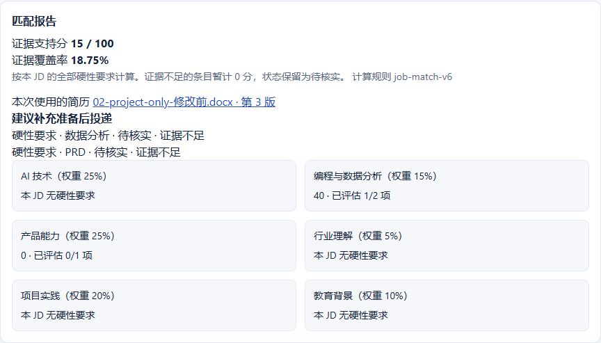
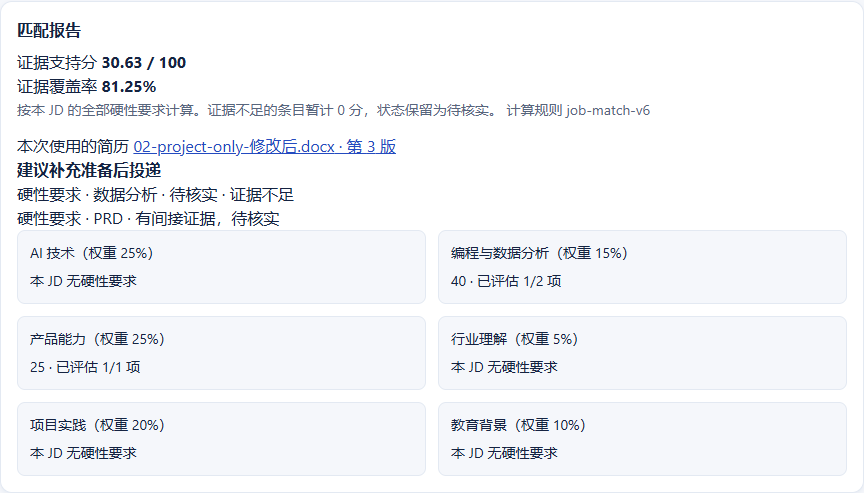

# 产品演示：补一条简历证据，用同一份 JD 复查

候选人只有课堂库存看板项目，没有产品实习。目标岗位是合成的 AI 产品实习，硬性要求包括 SQL、数据分析和产品需求文档（PRD）。演示使用同一个岗位、同一个 JD 修订和两份合成简历，在实际运行的本地产品中完成。

## 前后对照

| 逐项要求 | 修改前 | 修改后 |
| --- | --- | --- |
| SQL | 符合，证据来自简历自述 | 符合，证据来自简历自述 |
| 数据分析 | 待核实，暂计 0 分 | 待核实，暂计 0 分，报告提示补充真实分析经历 |
| PRD | 待核实，暂计 0 分 | 部分符合，引用新增的项目原文 |
| **证据支持分** | **15.00 / 100** | **30.63 / 100** |
| **证据覆盖率** | **18.75%** | **81.25%** |

| 修改前报告 | 修改后报告 |
| --- | --- |
|  |  |

## 演示步骤

1. **上传并确认修改前版本。** 在「AI 职业画像」上传合成简历，核对本地解析文本，按原文章节整理后确认。[上传校对](demo-resume-rematch/screenshots/01-upload-preview.png) · [结构确认](demo-resume-rematch/screenshots/02-confirm-before.png)
2. **录入和核对 JD。** 在「岗位匹配」录入合成 JD，解析后核对 SQL、数据分析和 PRD 三项原文，确认岗位要求。[录入](demo-resume-rematch/screenshots/03-enter-jd.png) · [核对 JD](demo-resume-rematch/screenshots/04-confirm-jd.png)
3. **找出一项可补的差距。** 用修改前的简历计算匹配，定位 PRD 待核实的条目，查看系统建议在对应经历补什么。[修改前逐项证据](demo-resume-rematch/screenshots/06-before-evidence.png)
4. **补写一处经历并确认新版。** 在合成案例的库存看板项目补写「撰写产品需求文档，定义库存周转监控指标」，将修改后的 DOCX 上传并确认。[修改后的项目段落](demo-resume-rematch/screenshots/07-confirm-edited-resume.png)
5. **用同一份 JD 复查。** 返回原岗位，选择新版简历并重新匹配。核对 PRD 引用的新原文，确认其余条目如何变化。可以通过历史记录分别打开两份报告。[修改后逐项证据](demo-resume-rematch/screenshots/09-after-evidence.png) · [历史报告](demo-resume-rematch/screenshots/10-match-history.png)

## 评分规则为什么调整

初版演示补上 PRD 证据后，参考分从 80 降到 45.62，暴露出一个比较口径问题。旧版只平均已有证据的条目，因此加进一条低于原平均值的证据就会拉低分数。

我将同一份 JD 的硬性要求分母固定，证据不足暂计 0 分，报告仍显示待核实及简历补充建议。用同一组材料复算后，新增的 PRD 原文增加了证据支持分，缺少依据的数据分析项仍显示待核实。PRD 当前是简历中的间接证据，独立验证还需要可核验的产出或测评。[评分与证据规则](../JOB_MATCHING.md)

## 可复现素材

[修改前简历](demo-resume-rematch/fixtures/02-project-only-before.docx) · [修改后简历](demo-resume-rematch/fixtures/02-project-only-after.docx) · [同一份合成 JD](demo-resume-rematch/fixtures/ai-product-internship-jd.txt) · [本地运行方法](README.md#本地运行)
