# AI Career Copilot 产品设计方案

阶段 11.3 · 2026 年 11 月 22 日

面向准备 AI 产品经理实习的学生。本文复盘现有产品怎样把简历、JD、项目证据、面试与学习任务串起来。功能审阅依据当前代码。体验假设、已知差距和后续设计在对应章节标注。原始 PRD 和 [阶段 11.2 PRD](PRD.md) 保留。

## 1. 产品功能架构

一级按用户要完成的任务划分，二级表示任务里的功能环节，三级是实际操作或产出。绿色分支突出首轮 MVP 的核心场景。功能范围来自现有 PRD、页面入口和已登记的服务，各项实现依据及验收边界见本节末尾。

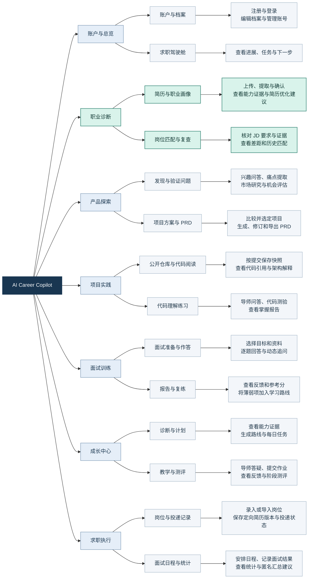

七个一级模块描述功能归属。实际侧栏分组见第 2 节。

### 功能服务的用户痛点

| 一级模块 | 用户遇到的问题 | 主要产出 |
| --- | --- | --- |
| 账户与总览 | 多次准备岗位后，容易找不回之前的进展或待办。 | 个人档案、私有记录、求职驾驶舱。 |
| 职业诊断 | 手里有项目和 JD，难以核对哪些经历能证明能力，也不知道哪项差距该先处理。 | 可查原文的能力证据、岗位匹配报告、复查记录。 |
| 产品探索 | 想做对口项目，难以判断从哪个真实问题切入。 | 痛点假设、公开来源、备选项目和可修订的 PRD。 |
| 项目实践 | 借助 AI 做出了项目，面试准备时讲不清代码、架构或边界。 | 固定提交的证据、代码讲解、测验和掌握报告。 |
| 面试训练 | 不清楚岗位相关的回答还有哪些薄弱点。 | 模拟会话、逐题复盘和下一步练习。 |
| 成长中心 | 知识、任务和实践分散，难以定下复练顺序。 | 能力诊断、学习路线、作业反馈和测评。 |
| 求职执行 | 同时投多个岗位时，难以追溯用了哪份简历、该跟进什么。 | 投递版本、状态历史、面试日程与统计。 |

### 模块之间传递的资料

1. **职业诊断到求职执行。** 投递记录绑定所使用的 JD、简历版本及匹配报告，后续可回到对应差距。
2. **职业诊断到产品探索和项目实践。** 探索会话可以关联指定匹配报告或投递。选定的方案可关联公开仓库，项目实践保留提交版本。
3. **准备资料到面试和成长。** 投递、PRD、公开仓库提交等可进入面试来源快照。面试报告的薄弱项可生成学习路线，并保留来源。
4. **模块进度到驾驶舱。** 当前账号的能力、任务和投递记录汇总到首页。独立入口也能使用，各模块归属与版本由服务端校验。

首轮试用的主线是确认简历和 JD、看报告、修改一处真实经历，再在首次看完报告后的 48 小时内用同一 JD 复查。当前前端支持选另一份已确认简历重新匹配，并逐份打开历史报告。逐项并排对照是待实现的改进方向，48 小时内完成复查的目标待真人试用验证。任务链已有合成账号验收，公开 GitHub 实时导入在该轮遇到配额限制，市场研究可使用已核对的公开补录资料。

依据 [阶段 PRD](PRD.md)、[实际路由](../../frontend/src/routes.ts)、[API 路由](../../backend/app/api/v1/api.py)、[跨模块来源绑定](../CROSS_MODULE_WORKFLOW.md) 和 [合成端到端验收](../PRODUCT_ACCEPTANCE.md)。

## 2. 产品信息架构

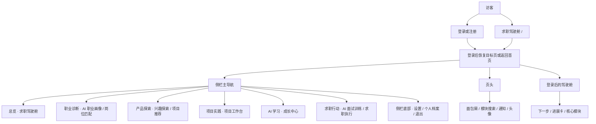

以 [routes.ts](../../frontend/src/routes.ts)、[App.tsx](../../frontend/src/App.tsx) 和 [布局组件](../../frontend/src/components/layout) 为准。首页、登录和注册支持访客。其它业务页在受保护路由内。窄屏通过按钮打开侧栏。页头搜索过滤模块列表，通知面板现呈现「暂无通知」，当前入口里没有通知取数逻辑。养成路径可在首页解释整体顺序，登录后使用数据汇总和下一步入口。

| 判断维度 | 当前设计复盘 | 改进方向 |
| --- | --- | --- |
| 导航理解 | 职业诊断对应简历和 JD，求职行动对应面试及投递。项目探索与项目实践名称接近，前者从问题形成方案，后者围绕已存在代码。 | 在入口用动词区分「找项目方向」与「读懂现有项目」。 |
| 重复入口 | 品牌、侧栏总览和面包屑都能回首页。头像与侧栏账户区都能进档案。搜索、驾驶舱卡片及侧栏重复指向业务页。 | 保留全局入口和上下文入口，具体报告、申请、方案、提交链接携带 ID。 |
| 入口命名与落点 | 驾驶舱的「项目理解与面试」卡片落在项目工作台，实际面试训练在侧栏「求职行动」，驾驶舱也有单独的面试状态入口。 | 试用时观察用户是否点错入口。若频繁误入，可把卡片改称「项目理解」，面试状态卡继续直达训练。 |
| 内容层级 | 兴趣探索和项目推荐使用同一组件、共享会话，通过不同路由呈现阶段。岗位匹配和求职执行均出现岗位相关内容，前者用于分析，后者用于跟踪。 | 在切换阶段显示当前会话及选中岗位，避免用户重新寻找刚打开的资料。 |
| 跳转 | 侧栏可自由换模块。用户也可以从投递进入既有匹配、项目和模拟面试，再由面试报告进入成长中心。 | 核对深链落点是否保留当前版本。对已删除来源明确显示历史和新建入口。 |

## 3. 三类用户旅程

三类是基于 PRD、项目负责人的自述及一位同学个案构建的使用假设。以下情绪、行为顺序和改进效果均待用户研究验证。

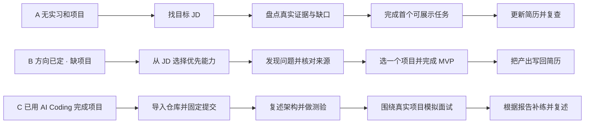

| 用户与目标 | 使用阶段与行为 | 触点、痛点及关键体验 | 情绪假设与改进机会 |
| --- | --- | --- | --- |
| A · 找到可开始的准备任务 | 选一份目标 JD，填档案，上传已有简历，核对原文和报告 | 职业画像区分自述、证据、未知；岗位匹配识别硬门槛和主要差距，缺少经历时仍可看到可行动的起点。 | 可能从无措到清楚下一步。检验空数据时能否找到一条当周可完成的任务。 |
| A · 建立第一份可展示证据 | 用兴趣探索或成长中心做小任务，再把真实产出写回简历并复查 | 用户常缺少项目和技能证据，任务、验收标准与同 JD 历史报告提供行动参照。 | 可能在动手时畏难，复查时获得反馈。观察能否快速定位前后变化。 |
| B · 做出目标岗位相关的项目 | 看差距，描述亲历场景，补充公开资料，对比候选方案 | 探索和推荐阶段确认痛点，标识来源和假设。用户可以选择有时间预算的方案并修订 PRD。 | 可能从选择太多转为可做决定。缩小首个项目的交付范围。 |
| B · 将实践转成求职证据 | 本地实现、审阅产出，更新简历或将报告绑定至投递 | 项目与岗位关联有助于解释结果如何对应 JD。实际开发与用户验证由用户执行。 | 可能担忧项目仍不够垂直。观察用户可否用一条复述讲清问题、决策和证据。 |
| C · 能讲清项目和个人贡献 | 导入公开仓库，定位文件，按提交检验理解，主动讲一遍 | 项目工作台提供文件、行号、讲解和测验。关键体验是核实自己参与的决策与代码行为。 | 可能在第一次深挖时紧张，发现具体盲点后更有方向。增加按核心链路复述的任务。 |
| C · 应对有针对性的追问 | 选 JD 或投递开练，作答，阅读薄弱项并练习 | 面试会话绑定来源，报告可把薄弱项带入学习路线，用户可拆解反思和补练。 | 可能在收到低覆盖结果时有压力，完成针对性复练后更有把握。检验用户能否独立说明技术取舍。 |

## 4. 九条业务流程

### 4.1 新用户注册及初始化

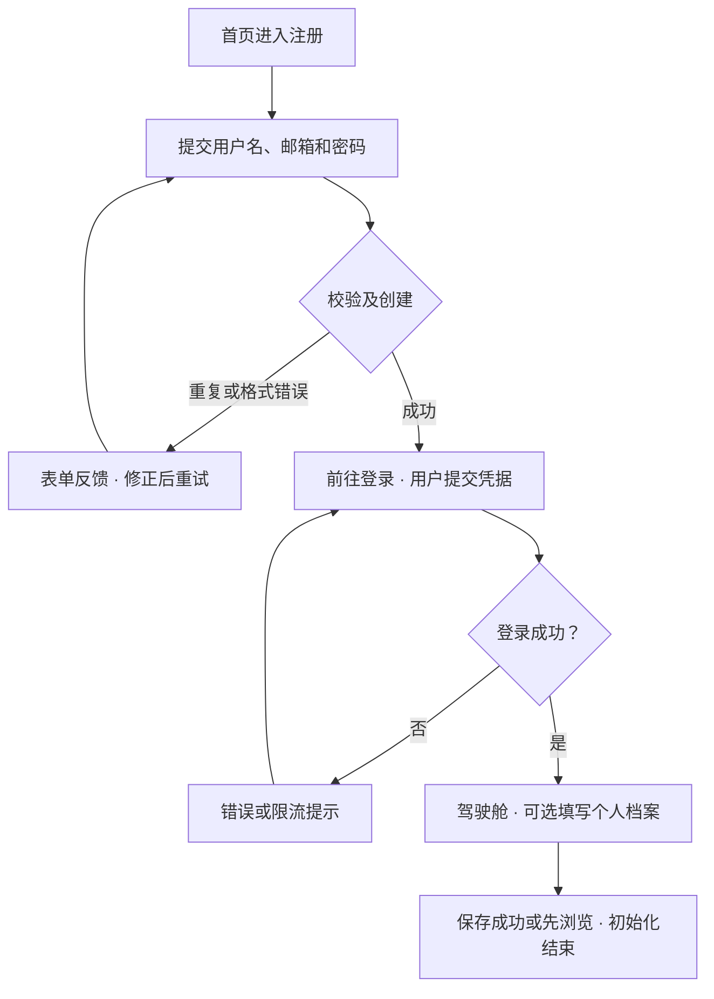

注册成功后引导登录。档案可稍后填，登录态检查与档案保存由确定性接口完成。此流程无 AI 文本生成，反馈为表单结果和登录后的下一步提示。

### 4.2 简历上传与职业画像

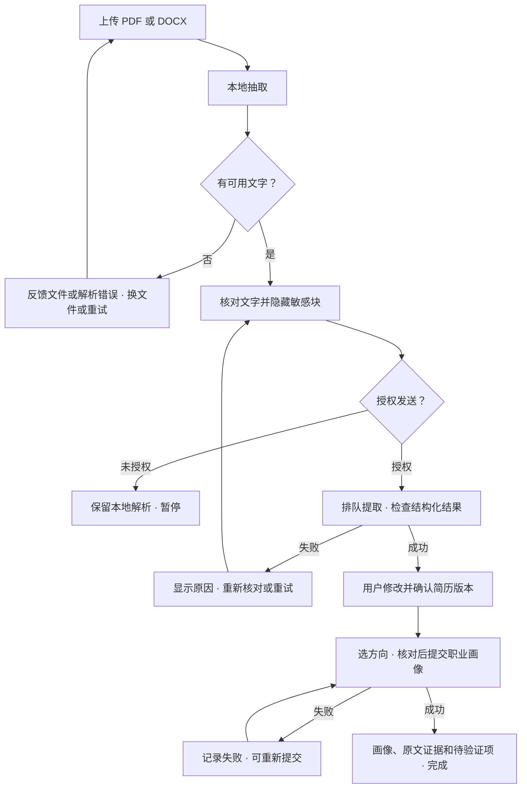

### 4.3 岗位 JD 解析与匹配

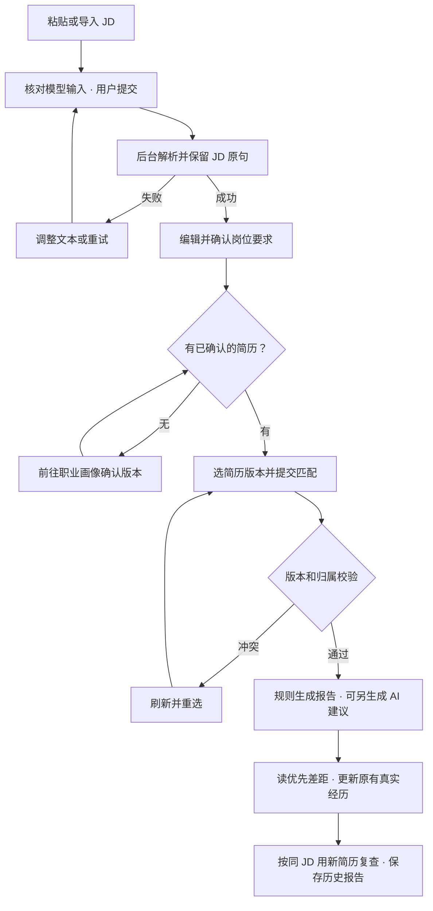

AI 建议失败时，原匹配报告仍可读。结束时保存版本与证据经历，用户可从报告进入求职执行。

### 4.4 兴趣探索与痛点挖掘

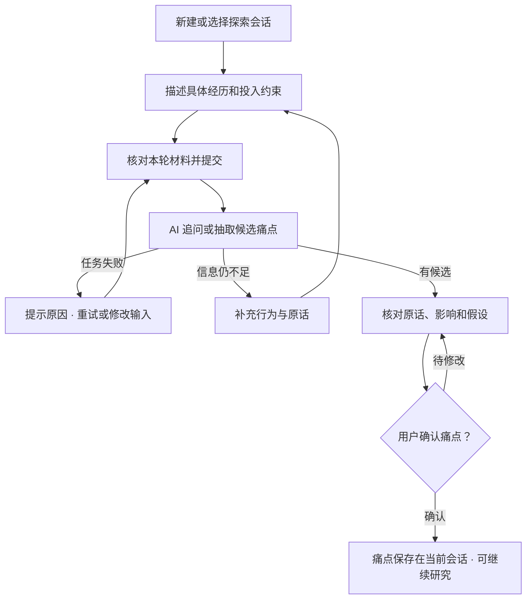

### 4.5 项目推荐与 PRD 生成

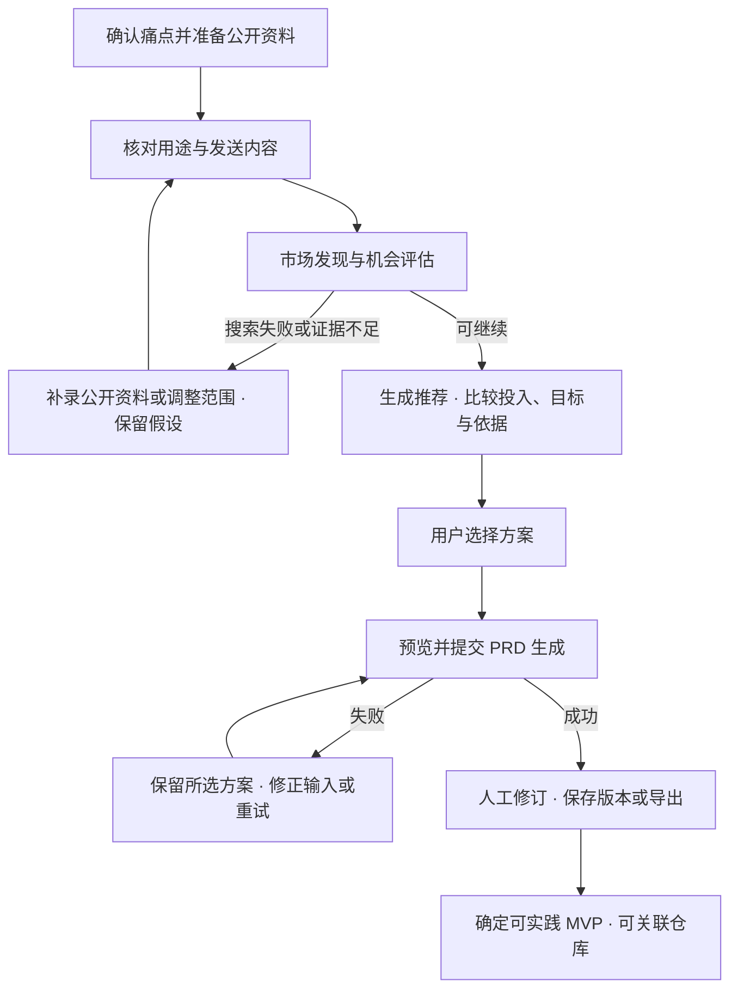

### 4.6 GitHub 导入与代码理解

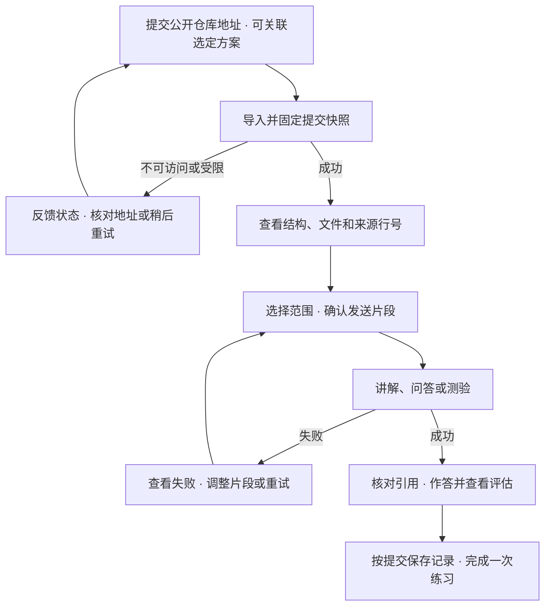

### 4.7 模拟面试与动态追问

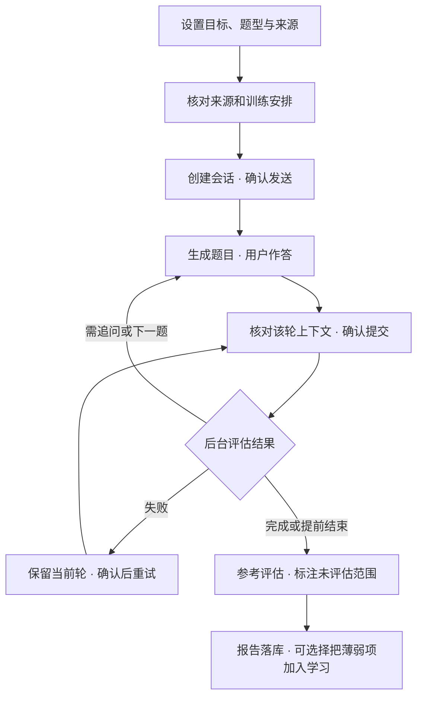

### 4.8 学习路线与能力提升

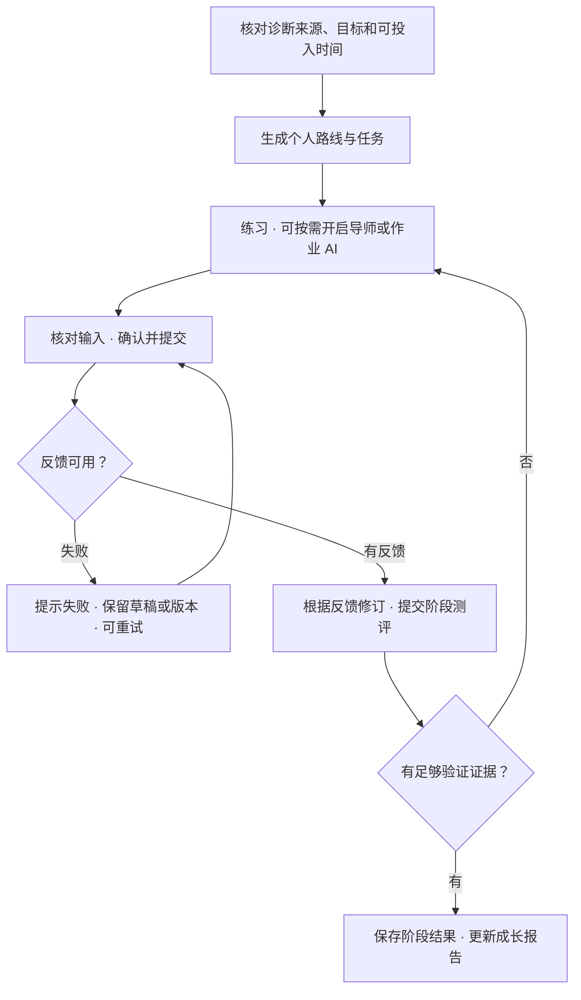

路线可由规则直接生成。导师补充与作业模型评价有独立预览确认，进度和掌握更新按验证证据处理。

### 4.9 简历定制与投递管理

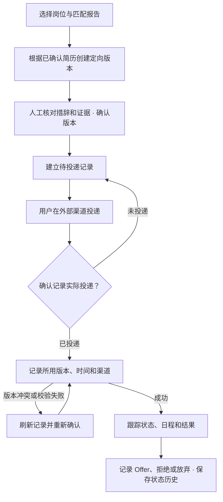

用户可以使用已确认的 AI 优化建议。保存版本和更新状态由后端规则完成。统计满足条件后可另行提交匿名汇总供 AI 给出建议。状态、投递记录与外部招聘结果由用户维护。

## 5. 当前页面与交互复盘

页面复盘结合现有 React 组件及截图。截图在本机 Edge 渲染原有前端，使用浏览器拦截后的合成 API 响应，覆盖首次访问和无记录场景。下表其他状态来自页面及组件代码，单张截图仅证明该画面实际渲染。阶段业务验收参见 [PRODUCT_ACCEPTANCE.md](../PRODUCT_ACCEPTANCE.md)。

| 页面与截图 | 目标、场景与布局 | 主操作和去向 | Loading | Empty | Error | Success |
| --- | --- | --- | --- | --- | --- | --- |
| [登录](screenshots/login.png) | 访客进入账户；统一账户表单 | 填邮箱密码、登录或切到注册；成功进入来源页或首页 | 检查登录态、提交中 | 初始表单 | 登录错误在表单展示 | 跳转工作区 |
| [注册](screenshots/register.png) | 新用户创建账号；用户名、邮箱、密码 | 生成账号，返回登录并带入邮箱 | 提交中 | 初始表单 | 校验、邮箱重复等提示 | 登录页显示注册成功 |
| [求职驾驶舱](screenshots/dashboard.png) | 登录后掌握目标与近期进度；欢迎区、下一步、进展、模块卡 | 前往档案、匹配、项目、面试、成长或求职执行 | 身份和进展分别加载 | 缺少数据时提示下一步，各摘要按缺项呈现 | 进展读取失败时可重试 | 展示目标岗位、模块进展和下一步 |
| [AI 职业画像](screenshots/career-profile.png) | 求职者核对经历；左侧简历，右侧详情、编辑和分析 | 上传、隐藏敏感块、确认结构化版本、查看画像及优化；供岗位匹配选择 | 页面载入，另有排队和处理中 | 从上传开始 | 分页面载入、操作、报告错误 | 显示已确认版本、证据和报告 |
| [岗位匹配](screenshots/job-matching.png) | 已有目标 JD；岗位列表和录入、详情核对、历史报告 | 解析、确认要求、换简历匹配、打开历史报告或下游操作 | 读取岗位、解析或建议任务 | 尚无岗位/历史报告或缺已确认简历 | 请求或任务异常提示 | 生成带证据、覆盖率和差距的报告 |
| [兴趣探索](screenshots/interest-exploration.png) | 提供亲历场景；左侧会话，右侧对话和研究 | 新建会话、确认痛点、分析机会并进入推荐 | 读取会话、后台任务 | 创建或选择会话 | 页面/任务提示并支持对应重试 | 保存回复、痛点和研究结果 |
| [项目推荐](screenshots/project-recommendations.png) | 有探索会话或目标岗位；会话列表与项目、PRD 详情 | 生成和比较项目、选方案、修订及导出 PRD、关联仓库 | 读取会话、生成任务 | 创建或选择会话 | 生成、更新或保存失败反馈 | 选中方案或保存 PRD 版本 |
| [项目工作台](screenshots/project-workspace.png) | 读懂公开代码；项目列表和项目详情分区 | 导入、选提交与文件、核对发送、读解释、答题 | 读取项目、导入或 AI 处理中 | 请导入或选择项目 | 显示导入和学习任务错误，可视情况重试 | 生成快照、讲解或测验记录 |
| [AI 面试训练](screenshots/interview-practice.png) | 岗位或项目模拟；配置、作答、报告和训练 | 核对来源、确认每轮内容、答题、收尾、将薄弱项加入学习 | 读取配置、轮询任务 | 没有训练或历史时先创建 | 预览、任务和提交异常提示 | 已作答证据、参考分、覆盖及建议 |
| [成长中心](screenshots/growth.png) | 制定计划并复练；诊断、路线、导师、任务、测评等分区 | 设置预算、选知识点、提交作业和看报告 | AI 在处理时显示状态，部分空面板随请求更新 | 未建路线、无每日任务或记录时显示对应引导 | 错误及可重试的后台任务 | 路线、反馈和阶段测评更新 |
| [求职执行](screenshots/application-workspace.png) | 多岗位投递；总览、岗位、版本、看板、日程、统计及策略 | 录入/导入岗位、绑定简历和报告、记录外部投递、从日程练习 | 读取工作台或正在操作 | 无待办、无面试、统计样本不足 | 操作错误或分页/统计反馈 | 对应列表刷新、状态历史保存 |
| [个人档案](screenshots/profile.png) | 编辑教育、目标、技能和经历；分段表单 | 新建、编辑并保存，驾驶舱回显目标 | 载入或保存中 | 未建档提示 | 读取和保存校验提示 | 档案已保存 |
| [设置](screenshots/settings.png) | 账户与数据删除；独立危险操作表单 | 填密码、理解影响并确认，成功退回登录 | 提交中 | 初始确认表单 | 密码或请求失败提示 | 账户删除后退出 |

复盘证据优先来自 [页面源码](../../frontend/src/pages)、[应用布局](../../frontend/src/components/layout) 和 [跨模块来源绑定](../CROSS_MODULE_WORKFLOW.md)。建议在后续设计验证中统一空状态的主操作位置、增加同 JD 的前后差异视图，并检查较复杂页面能否从深链直接定位目标分区。

## 6. AI 交互设计

| 交互阶段 | 当前行为 | 产品边界及后续验证 |
| --- | --- | --- |
| 用户提供材料 | 输入简历、JD、经历、公开来源、提交对应代码片段、面试回答或学习作业。需外发的场景提供预览或明确确认。 | 核对真实交互中用户能否找到外发范围、模型服务和撤回入口。 |
| 追问 | 探索时基于现有对话问具体场景；面试根据已答内容和剩余题量追问；学习用导师模式组织解释和练习。 | 无来源的推断标待核对。需要补资料时问可回答的具体问题。 |
| 等待反馈 | 后台任务显示等待、处理中、成功或失败，页面按任务轮询。 | 用户应能理解已提交的是哪版材料、何时需要重试。 |
| 展示结果 | 画像用能力证据，匹配用 JD 条目和分维度报告，代码用固定提交与行号，面试用作答依据、覆盖率和薄弱项。 | 参考分的解释应靠近证据。真实岗位选择由用户做出。 |
| 纠错与确认 | 用户可修改结构化简历、调整岗位要求、编辑痛点或 PRD、重跑分析。面试报告主要通过查看依据和再次练习纠正。 | 后续可验证报告条目级纠错入口，复查时保留来源和不同版本。 |
| 失败处理 | 外部服务、权限、限流、材料变更或不合规输出由对应任务和页面反馈。可重试操作回到已有输入或预览。 | 失败记录和上一版结果应继续可见，涉及重新发送时让用户知道范围。 |

六条详细工作流、Prompt、模型输入、业务验证及存储见 [AI 工作流](AI_WORKFLOW.md)。

## 7. 产品设计决策记录

| 决策 | 依据 | 现状及待验证 |
| --- | --- | --- |
| 以岗位差距为首轮主线 | 项目负责人先遇到简历筛选和准备优先级问题，同一 JD 便于观察变化 | 已支持按简历版本复查和逐份报告。48 小时复查比例、是否理解差距排序待试用。 |
| 任务入口与上下文入口并存 | 有人从 JD 开始，也有人带着现成项目直接去练习 | 侧栏与驾驶舱指向入口，跨页可携带具体报告、投递或方案。可用任务测试验证用户能否找到目标页。 |
| 同时保留简历版本、JD 版本与 Git 提交 | 跨模块资料会变更，需要可追溯 | 投递与面试使用来源记录或快照，老记录按业务规则兼容。 |
| 结果按证据而非单一评分组织 | 评分受证据覆盖和模型推断影响 | 可回看简历原文、JD 引用、代码行号和具体作答。逐项比对属于后续设计。 |
| 将外发确认放在任务执行之前 | 简历、经历、作答或代码片段可能包含用户不愿发送的内容 | 预览、主机提示、用户提交和服务端约束已能在对应路径查到。 |
| 学习状态由可记录的成果推动 | 仅阅读建议难以证明掌握 | 以作业、客观题或复练结果更新记录，目标用户使用成效仍待验证。 |

本阶段依据历史合成端到端验收和本轮设计证据。真人用户旅程、48 小时同 JD 复查率及外部提供方实时表现保留为后续验证项。
