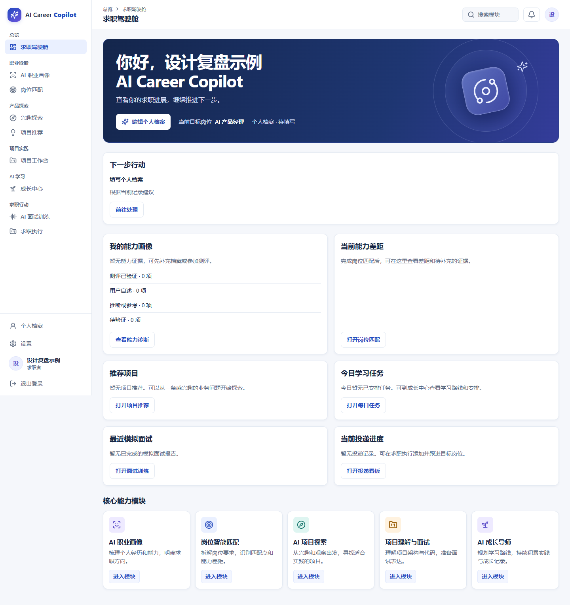
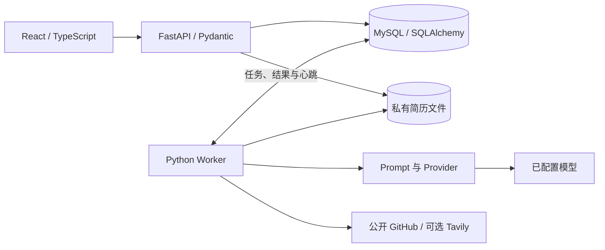

# AI Career Copilot · AI 求职成长助手

面向准备 AI 产品经理实习的大学生和研究生。用一份简历和一份目标 JD 找出优先差距，决定该补哪条经历、做哪项项目或练哪类面试题。修改之后可使用同一 JD 复查，历史报告保留输入版本与证据。

[作品集](PORTFOLIO.md) · [产品案例](PROJECT_CASE_STUDY.md) · [演示脚本](DEMO_SCRIPT.md) · [PRD](PRD.md)

## 背景与用户

项目发起人曾多次投递实习无果。他发现，已有项目与目标 AI 产品岗位不够贴合，很难在简历里证明产品能力。身边一位有多段实习的同学也曾在 AI 产品岗位面试中受挫。由此提出首个假设：已经学习并实践过、但缺少对口实习的学生，需要先识别差距，再决定投入时间的顺序。以上来自个人经历及一个同学个案。

## 产品功能

| 入口 | 用户能完成的任务 |
| --- | --- |
| 求职驾驶舱、个人档案 | 维护教育、目标和经历，查看当前报告、任务及进度 |
| AI 职业画像 | 上传 PDF 或 DOCX，在本地解析后核对拟发送的文字，确认版本，查看证据与优化建议 |
| 岗位匹配 | 导入 JD、确认岗位要求，对照简历证据、看优先差距和覆盖率，复查修改版 |
| 产品探索 | 从亲历的问题出发，经追问、痛点和来源核对，比较候选项目并修订 PRD |
| 项目工作台 | 导入公开 GitHub 仓库，按提交查看文件、代码引用与讲解，完成理解测验 |
| AI 面试训练与成长中心 | 基于岗位和实际资料模拟面试，把薄弱项转成学习任务，继续练习和测评 |
| 求职执行 | 管理岗位、定向简历版本、状态、面试日程及复盘 |

## 产品截图

以下来自真实前端在浏览器中的运行画面，采用合成 API 响应，展示初次进入及空记录状态。



[职业画像](screenshots/career-profile.png) · [岗位匹配](screenshots/job-matching.png) · [项目工作台](screenshots/project-workspace.png) · [AI 面试训练](screenshots/interview-practice.png) · [求职执行](screenshots/application-workspace.png)

## 架构与 AI 设计



前端使用 React、TypeScript、Vite、Tailwind CSS 和 React Router。后端采用 FastAPI、Pydantic、SQLAlchemy、MySQL 8.4、Alembic、JWT 和 Argon2。Docker Compose 可组织 Caddy、API、Worker、迁移和数据库。模型历史基线使用阿里云百炼 `deepseek-v4.1-flash`。

模型负责从非结构化文本提取与生成。Python 负责鉴权、版本、队列、评分、证据检查和状态变更。岗位匹配先核对原句，再按规则计算匹配和覆盖率。公开代码用 Git SHA 和行号定位。外发材料经用户核对，响应先过 Pydantic，再核对引用和业务条件。多轮交互的会话保存在数据库，由程序选择上下文。当前无自主 Agent、向量库或模型工具调用。[系统架构](SYSTEM_ARCHITECTURE.md) · [AI 工作流](AI_WORKFLOW.md)

## 目录

```text
frontend/src/         页面、布局、路由和 API 服务
backend/app/         FastAPI、业务服务、模型、Prompt、Worker
backend/alembic/     数据库版本迁移
backend/tests/       接口、专项与产品验收测试
deploy/              本地、测试与生产环境模板
scripts/             Windows 本地启动工具
docs/                设计、部署、测试与运营
docs/stage11/        作品集及项目学习文档
```

## 本地运行

以下命令从仓库根目录开始。Windows 原生开发使用 Python、Node.js 和 MySQL 8.4。也可按 [Docker 部署](../DEPLOYMENT.md) 使用独立的 Compose 服务和卷。

```powershell
python -m venv backend/.venv
& backend/.venv/Scripts/python.exe -m pip install -r backend/requirements.txt
npm.cmd --prefix frontend ci
Copy-Item backend/.env.example backend/.env
```

先按 [数据库初始化](../DATABASE.md) 在 MySQL 创建专用数据库与应用账号，然后填写 `backend/.env`。数据库连接使用 `DB_HOST`、`DB_PORT`、`DB_NAME`、`DB_USER` 和 `DB_PASSWORD`。另填独立的 `JWT_SECRET`，并确认本地前端来源在 `CORS_ORIGINS` 中。只需基础体验时可将模型配置留空。有授权的模型环境设置 `LLM_BASE_URL`、`LLM_MODEL`、`LLM_API_KEY`，市场搜索可选 `TAVILY_API_KEY`。本机环境文件只在本地保存。

```powershell
Set-Location backend
& .venv/Scripts/python.exe -m alembic upgrade head
& .venv/Scripts/python.exe -m alembic current
& .venv/Scripts/python.exe -m uvicorn app.main:create_app --factory --host 127.0.0.1 --port 8001
```

另一终端从根目录运行 `npm.cmd --prefix frontend run dev`，访问 [本机驾驶舱](http://127.0.0.1:5173/) 或 [本机 API 文档](http://127.0.0.1:8001/docs)。后台用第三个终端在 `backend` 启动 `python -m app.resume_worker`（或虚拟环境中的同一 Python）。仅在显式启用已授权模型时按部署说明加 `--approved-host`，并确认是隔离演示资料。参见 [运行手册](../OPERATIONS.md)。

## 测试

```powershell
npm.cmd --prefix frontend run typecheck
Set-Location backend
& .venv/Scripts/python.exe -m pytest -q tests/test_ai_evaluation.py
```

API 和端到端测试需要独立迁移后的 MySQL 测试库，设置 `APP_ENV=test`、`DB_NAME` 以 `_test` 结尾，使用合成数据和受控模型响应。 [测试计划](../TEST_PLAN.md) · [端到端验收](../PRODUCT_ACCEPTANCE.md) · [AI 评测](AI_EVALUATION.md)

## 已知限制与迭代

历史隔离集成回归为 120 通过、10 跳过。历史真实模型基线在 12 个合成样本中 9 个通过全部业务检查，不能外推总体质量。公开 GitHub 导入受配额影响，早期主链采用受控响应。扫描 PDF 需要用户提供可抽取文字的版本。页面可以分别查看历史匹配报告，逐项并排对照属于后续设计。真人 48 小时闭环和生产公网环境仍待验证。

下一轮优先验证用户能否独立解释首要差距、补一条真实证据、用同一 JD 复查。验证结果再决定是否优先做并排对比、差距排序或修改入口。
