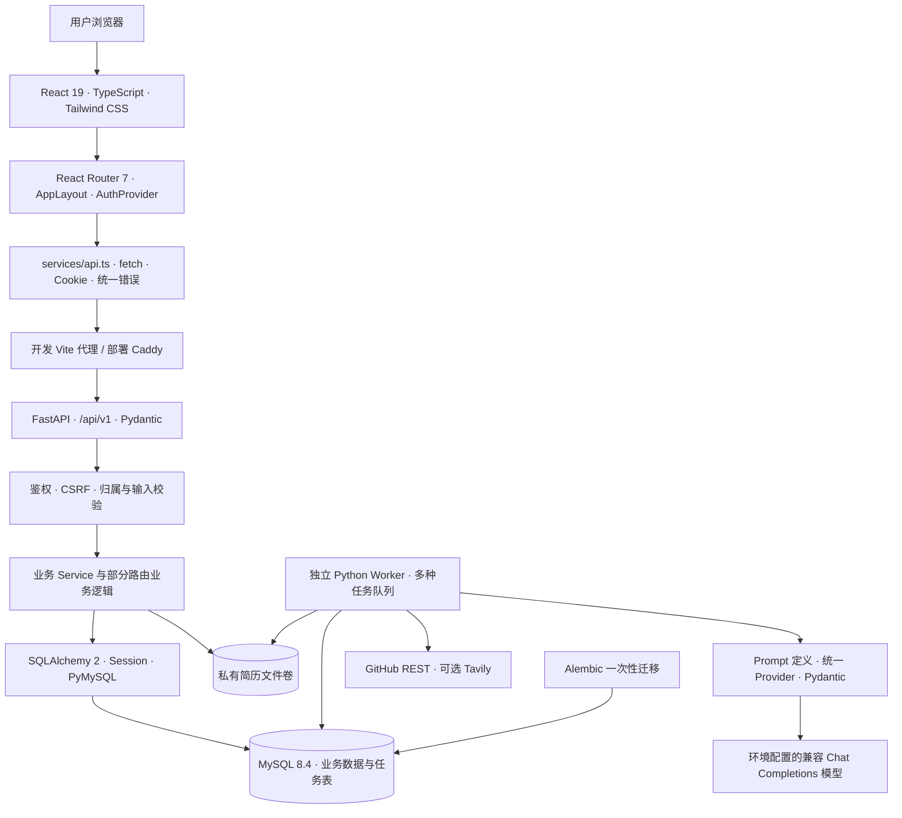

# AI Career Copilot 系统架构

阶段 11.4 · 2026 年 11 月 22 日

## 1. 系统边界与总体架构

AI Career Copilot 面向准备 AI 产品经理实习的学生。用户在浏览器完成职业画像、JD 对照、项目实践和面试复盘。系统保存与任务对应的简历版本、岗位要求和证据，便于用户用同一 JD 复查改动。投递发生在外部招聘渠道，产品记录用户自己的投递进展。

| 层或组件 | 当前职责与入口 |
| --- | --- |
| Web | [main.tsx](../../frontend/src/main.tsx) 初始化应用；[App.tsx](../../frontend/src/App.tsx) 装配路由；[routes.ts](../../frontend/src/routes.ts) 定义导航标题和分组。驾驶舱首页可访客访问；登录、注册公开；职业画像、岗位匹配、探索/推荐、项目工作台、面试、成长、求职、档案及设置使用受保护路由。 |
| 请求层 | [services/api.ts](../../frontend/src/services/api.ts) 使用默认同源 `/api/v1`、携带凭据、添加写请求头并解析错误。 [AuthProvider](../../frontend/src/hooks/AuthProvider.tsx) 在加载时读取当前用户，管理会话与档案。 |
| FastAPI 和 Service | [main.py](../../backend/app/main.py) 创建应用，挂载版本化 [API Router](../../backend/app/api/v1/api.py)、错误处理和运行探针。[dependencies.py](../../backend/app/api/dependencies.py) 校验登录用户与浏览器来源。端点调用 [services/](../../backend/app/services) 或在端点内组织简单事务。 |
| 数据访问 | [session.py](../../backend/app/db/session.py) 集中配置 Engine、连接池和 Session，路由或服务直接在 SQLAlchemy Session 上执行查询和提交。[models](../../backend/app/models) 声明业务表；[Alembic env](../../backend/alembic/env.py) 复用同一 metadata。 |
| 文件 | 简历原件由 [resume_storage.py](../../backend/app/services/resume_storage.py) 存入私有位置；数据库记录存储键、版本、任务和可引用文本。删除账号时事务写入待清理记录，由后台重试文件删除。 |
| 异步任务 | [resume_worker.py](../../backend/app/resume_worker.py) 是实际进程入口，调用 [worker_scheduler.py](../../backend/app/services/worker_scheduler.py) 调度多个模块的任务，并维护心跳。任务状态持久化在各模块表，页面读取轮询。 |
| AI 与外部服务 | 模块在 Python 中构建上下文，版本化 Prompt 和 [Provider](../../backend/app/ai/provider.py) 共用调用机制；[Prompt Registry](../../backend/app/prompts/registry.py) 登记与检查基线。代码导入使用 [GitHub 服务](../../backend/app/services/github_service.py)，市场研究可使用 [Tavily 服务](../../backend/app/services/market_research_service.py) 或人工补录公开资料。 |

## 2. 认证、数据归属与持久化

浏览器登录使用 `POST /api/v1/auth/session`，响应设置 HttpOnly、SameSite=Lax Cookie，生产启用 Secure。CLI 等非浏览器用 `POST /api/v1/auth/login` 获取 Bearer Token。两类 JWT 使用不同 audience；浏览器写入检查配置中的精确 Origin 与自定义请求头。密码验证使用 Argon2。数据库查询以认证用户身份限定归属；跨模块还校验岗位、版本和资料来源是否对应。

一次普通请求由 Session 读取或提交；模型任务先保存指纹、任务状态和材料，Worker 认领后在长调用期间避免持有认领事务。完成后依据当前任务和版本状态持久化结果。报告需能回溯至当时的简历、JD、Git 提交或作答。数据模型和版本关系见 [数据库设计](DATABASE_DESIGN.md)。

## 3. 核心调用链

以下 API 路径以 `/api/v1` 为前缀，表名及键见数据库文档，六条实际时序见 [架构图与业务时序](ARCHITECTURE_DIAGRAMS.md)。

| 流程 | 前端及 API | 真实函数、模型调用和存储 |
| --- | --- | --- |
| 注册和登录 | [AuthPage](../../frontend/src/pages/AuthPage.tsx)、[auth.ts](../../frontend/src/services/auth.ts)。`POST /auth/register`、`POST /auth/session`、`GET /users/me` | `auth.register_user` → `auth_service.register`；`auth.create_session` → `authenticate`、`issue_token`；`current_user`恢复身份。写入 `users`，档案单独创建。全程为业务逻辑。 |
| 简历和画像 | [CareerProfilePage](../../frontend/src/pages/CareerProfilePage.tsx)、[career.ts](../../frontend/src/services/career.ts)。`POST /resumes/upload`、`POST /resumes/{id}/parse`、`GET /resumes/{id}/preview`、`POST /resumes/{id}/extract`、`PUT /resumes/{id}/content`、`POST /career/analyze` | `resumes.create_resume` 写文件；`resume_jobs.start_job` 排队；`resume_worker.compute` 本地抽取或用 EXTRACT、ANALYZE、OPTIMIZE 调 `Provider.generate`；`complete` 保存简历版本、画像、技能证据及优化。 |
| JD 和岗位匹配 | [JobMatchingPage](../../frontend/src/pages/JobMatchingPage.tsx)、[jobs.ts](../../frontend/src/services/jobs.ts)。`POST /jobs/{id}/parse`、`PUT /jobs/{id}/requirements`、`POST /jobs/{id}/match` | `job_workflow.run_job_once` 调 `job_parser.parse_jd` 使用模型；`jobs.create_match` 用 `job_matching_service.candidate`、`score` 和 `skill_gap_service.enrich` 生成报告；可单独确认 AI 建议。存入岗位、要求、匹配、差距和任务表。 |
| 产品探索 | [ProductDiscoveryPage](../../frontend/src/pages/ProductDiscoveryPage.tsx)、[discovery.ts](../../frontend/src/services/discovery.ts)。`POST /discovery/sessions`、`POST /discovery/sessions/{id}/preview`；各生成步骤独立提交 | `career_context.discovery_binding` 验证投递与报告来源；`discovery_workflow.run_discovery_once` 驱动 `compute`，由 Provider 处理对话、痛点、研究归纳、机会、推荐和 PRD，保存会话、证据、推荐及 PRD 版本。 |
| GitHub 和代码 | [ProjectWorkspacePage](../../frontend/src/pages/ProjectWorkspacePage.tsx)、[codeProjects.ts](../../frontend/src/services/codeProjects.ts)。`POST /code-projects/import`、`GET /code-projects/{id}/files`、`POST /code-projects/{id}/preview`、`POST /code-projects/{id}/explain` | `code_projects.import_repository` 构建导入任务；`run_code_project_once` 分派 `collect_repository` 或 `model_result`；`project_knowledge_service.citations` 取代码证据。仓库、固定提交、文件、课程/讲解、测验与尝试分表存储。 |
| 模拟面试 | [InterviewPracticePage](../../frontend/src/pages/InterviewPracticePage.tsx)、[interview.ts](../../frontend/src/services/interview.ts)。`POST /interviews/prepare`、`POST /interviews/sessions`、会话内 `/preview`、`/start`、`/answers`、`/finish` | `interview_engine.generation_input` 形成阶段和证据上下文，`submit` 入队，`run_interview_once` 调模型，`complete` 校验与推进，`interview_report_service.finish` 保存报告和复练任务；会话、题、答、任务均可追溯。 |
| 学习与成长 | [GrowthCenterPage](../../frontend/src/pages/GrowthCenterPage.tsx)、[learning.ts](../../frontend/src/services/learning.ts)。`POST /learning/paths/generate`、`POST /learning/preview`、`POST /learning/sessions/{id}/messages`、`POST /learning/assessments/{id}/submit` | `learning_plan.diagnosis`、`make_path` 按证据建路线；`learning_workflow.run_learning_once` 生成导师回复或作业反馈；`learning.submit_assessment` 按题库评分，再写掌握历史和调整路线。驾驶舱读取聚合状态。 |
| 求职执行 | [ApplicationWorkspacePage](../../frontend/src/pages/ApplicationWorkspacePage.tsx)、[applications.ts](../../frontend/src/services/applications.ts)。`POST /applications`、`POST /applications/{id}/status`、`GET /job-analytics` | `career_context.application_match` 选择匹配来源；[application_tracking_service.py](../../backend/app/services/application_tracking_service.py) 保留投递版本及历史。另有 `job_strategy_service.run_strategy_once`，用户确认后用匿名汇总请求策略建议。 |

## 4. 运行、部署和当前状态

| 范围 | 状态与证据 |
| --- | --- |
| 登录、确认简历、JD 匹配、探索、仓库样例、面试、学习与投递关联 | **已实现且历史测试通过。** 独立 MySQL 8.4 测试库、合成账号、受控模型和 Edge 验证主线，证据见 [端到端验收](../PRODUCT_ACCEPTANCE.md)。 |
| 真实模型 | **已有历史合成样本验证。** 本轮读取本地模型配置，确认为阿里云百炼 `dashscope.aliyuncs.com` 的 `deepseek-v4.1-flash`、`json_object` 模式。实时调用与生产启用情况另行核验。 [AI 质量基线](../AI_EVALUATION.md) |
| GitHub 与搜索 | **部分实证。** GitHub 读取实现及受控验收存在；历史 GitHub 实时检查遇到配额，Tavily 有实现及合成流程，正式上线前需在获授权环境复查。 |
| 容器与部署 | **配置已实现，生产运行待验证。** [Compose](../../compose.yaml) 运行 MySQL 8.4、一次性 Alembic 迁移、API、Worker、Caddy。 [生产覆写](../../compose.production.yaml) 设生产环境和 HTTPS 域名。[Caddyfile](../../frontend/Caddyfile) 代理健康与 API 路径并为 React 深链回退。生产容器启动、实际域名和 HTTPS 需单独验收。 |
| 同 JD 前后并排对比、真人价值验证 | **仅有设计或验收计划。** 当前可分别读取历史报告，48 小时复查率待试用。 |

运行上 `/health` 用于进程存活，`/ready` 核对数据库和完整 Worker 心跳。普通开发环境可用进程内限流，生产配置通过数据库共享限流。发布、回滚和配对备份见 [部署与恢复](../DEPLOYMENT.md)。

## 5. 历史文档差异

- 原 [技术架构](../ARCHITECTURE.md) 的第一阶段章节保留早期占位页和演示任务。当前驾驶舱读取真实账户数据，已接入各阶段业务页，入口取自当前路由。
- 技术架构早期章节以进程内限流为开发方案。当前代码还有生产共享限流和过期清理，应用启动和模型任务处理均可核对。
- 原立项说明列出将来可选的 Agent、RAG 和 Function Calling。当前实现是 Python 组织任务、有限来源检索及结构化模型调用，能力分类见 [AI 技术架构](AI_WORKFLOW.md)。
- 旧项目资料中若将阶段路线图、发布配置或样例成功直接写成真实外部服务已测，应按上表相应证据表述。架构文档记录实现及验证边界，不记录用户商业效果。
